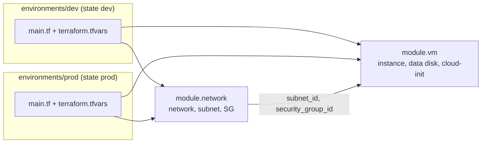

# Воркшоп «Terraform: модули, окружения, best practices» (Yandex Cloud)

Полный комплект материалов: сценарий, слайды, репозиторий, ДЗ, материалы проверяющего.
Все файлы кода лежат в репозитории `yandex-terraform-modules-webinar/` рядом с этим документом; здесь они подставлены дословно.

## 0. Что проверено, что нет, и допущения

**Проверено по первоисточникам (на 2026-10-06):**
- Backend `s3` для Object Storage: `endpoints.s3 = https://storage.yandexcloud.net`, `region = ru-central1`, флаги `skip_region_validation`, `skip_credentials_validation`, `skip_requesting_account_id`, `skip_s3_checksum` (документация Yandex Cloud, применимо к Terraform ≥ 1.6.3).
- Блокировка в документации Yandex Cloud описана **только через YDB** (`dynamodb_table`, Document API), и объявлена устаревшей начиная с Terraform 1.11. Про `use_lockfile` документация Yandex Cloud молчит. Object Storage поддерживает условную запись `If-None-Match` при загрузке, на этом механизме строится lock-файл. Вывод: `use_lockfile = true` **вероятно работает, но не подтверждено документацией: проверьте на своём бакете до вебинара** (процедура в `instructor/prep-checklist.md`), запасной вариант YDB описан.
- Квоты (документация VPC): сети — 2 **на облако** (не на каталог), подсети — 12, security groups — 10, публичные адреса — 8 (статические — 2). Автосозданная сеть `default` входит в квоту. Квоты Compute: 12 ВМ, 32 vCPU, 128 ГБ RAM; в документации указан переход ряда квот на зонное распределение с 12.10.2026.
- В `yandex_compute_instance` **нет** аргумента `deletion_protection` (проверено по документации провайдера и Yandex Cloud), а `lifecycle.prevent_destroy` принимает только литералы. Поэтому «`prevent_destroy = true` в prod только через параметры» невозможно буквально: в материалах это решено сторожем `terraform_data.destroy_guard` на уровне окружения (раздел 4, блок 4) и объясняется студентам как полезный разбор «чего Terraform не умеет».
- Актуальные версии на момент подготовки: Terraform 1.16.x, провайдер yandex 0.235.0, pre-commit-terraform v1.109.2, gitleaks v8.30.1.

**Не проверено выполнением:** на этой машине нет Terraform, поэтому код **не прогонялся** через `fmt`/`validate`/`plan`. Выверка идёт по документации и вручную. **Перед вебинаром выполните**: `terraform fmt -check -recursive`, `terraform init -backend=false && terraform validate` в обоих окружениях и в `00-start`, и прогон демо на реальном каталоге. Ожидаемые выводы `plan`/`apply` ниже помечены «примерный вывод».

**Допущения (скорректируйте, если не так):**
1. Аудитория новая: Terraform многие видят впервые, поэтому основы (цикл `init → plan → apply → destroy`, `provider`/`resource`/`variable`/`output`/`state`) повторяем кратко и по ходу демо. Облако у каждого пустое; квота сетей 2 на облако; если `00-start` разворачивали, к ДЗ его нужно уничтожить.
2. Имена в `00-start`: сеть `workshop-network`, подсеть `workshop-subnet` (`10.0.1.0/24`), SG `workshop-web-sg`, диск `workshop-web-data` (5 ГБ), ВМ `workshop-web` (`standard-v3`, 2 vCPU, 4 ГБ). Они подобраны так, чтобы модули воспроизвели их без пересоздания; если меняете имена в `00-start`, меняйте `name_prefix` и ключ в `servers` в `terraform.tfvars` dev.
3. ОС лектора и студентов смешанные: путь к SSH-ключу — параметр, а не код.
4. Истории из SRE-практики в сценарии — **заготовки**: подставьте свои реальные случаи.

**Реестр мест «ПРОВЕРИТЬ ПО ДОКУМЕНТАЦИИ» (сводка):**

| Что | Где проверить |
|---|---|
| `use_lockfile` с Object Storage | Тест на своём бакете; https://yandex.cloud/ru/docs/tutorials/infrastructure-management/terraform-state-storage |
| Допустимые `core_fraction` для `standard-v3` (20/50/100) | https://yandex.cloud/ru/docs/compute/concepts/performance-levels |
| Список зон (a/b/d) | https://yandex.cloud/ru/docs/overview/concepts/geo-scope |
| Квоты (сети, vCPU) и переход на зонные квоты с 12.10.2026 | Консоль «Квоты», https://yandex.cloud/ru/docs/vpc/concepts/limits, https://yandex.cloud/ru/docs/compute/concepts/limits |
| Минимальные роли для ДЗ (`vpc.admin`, `compute.editor`) | https://yandex.cloud/ru/docs/iam/concepts/access-control/roles |
| Точный текст ошибки `prevent_destroy` и квот | Запуск на своей версии Terraform |
| Актуальная версия провайдера | https://registry.terraform.io/providers/yandex-cloud/yandex/latest |
| `terraform providers lock` для нескольких платформ | https://developer.hashicorp.com/terraform/cli/commands/providers/lock |

---

## 1. Название и аннотация

**Terraform в проде: модули, окружения и best practices** (воркшоп по Terraform и Yandex Cloud)

> Берём работающий стенд, собранный одним плоским `main.tf` (сеть, ВМ с nginx, диск). За час превратим его в проект, который не стыдно показать на ревью: вынесем код в модули, соберём из них `dev` и `prod`, вынесем state в Object Storage и разберём практики, которые снижают тойл и делают изменения предсказуемыми. Практики на вебинаре нет: вы получите домашнее задание и сдадите его на проверку.

**Что подготовить до вебинара:** Terraform 1.10 или новее, `yc` CLI, облако с каталогом, SSH-ключ (`ssh-keygen -t ed25519`). Опыта с Terraform не требуется: основы повторяем по ходу.

**Что студент унесёт:**
- структуру Terraform-проекта «модули + окружения + раздельный state» (РО1);
- умение вынести повторяющийся код в переиспользуемый модуль с хорошим интерфейсом (РО2);
- приём `moved` для рефакторинга без пересоздания ресурсов;
- чек-лист best practices: секреты, lock-файл, версии, `tflint/checkov`, `plan` в PR;
- репозиторий-образец и домашнее задание на 1,5–2 часа.

**Образовательные результаты:** РО1 — проектировать структуру Terraform-проекта под реальное продакшн-применение; РО2 — выносить повторяющийся код в переиспользуемые модули.

---

## 2. Вступление: что не так в плоском стартовом проекте и что улучшаем

| № | Проблема стартового проекта (`00-start`) | Что улучшаем сегодня | Где в материалах |
|---|---|---|---|
| 1 | Всё в одном `main.tf`; имена, CIDR, зона, размеры, путь к ключу захардкожены; для второго окружения копируем файлы | Модули `network` и `vm`; параметры в `terraform.tfvars`; dev/prod из одного кода (РО1, РО2) | `modules/`, `environments/` |
| 2 | Три почти одинаковых блока `ingress` (22, 80, 443) | `dynamic "ingress"` по `map` правил | `modules/network/main.tf` |
| 3 | `.terraform.lock.hcl` в `.gitignore`, нет `required_version` и версии провайдера | Lock-файл коммитим; `required_version >= 1.10`, `version = "~> 0.235"` | `.gitignore`, `environments/*/versions.tf` |
| 4 | OAuth-токен открытым текстом в `terraform.tfvars`, переменная не `sensitive` | `YC_TOKEN` из окружения (или сервисный аккаунт); переменной нет; `sensitive` разбираем | `environments/*/main.tf` |
| 5 | SSH (22) открыт на `0.0.0.0/0` | `ssh_allowed_cidrs`; в prod валидация запрещает `0.0.0.0/0` | `environments/prod/variables.tf` |
| 6 | `file("~/.ssh/id_rsa.pub")` зависит от машины запускающего (у других ключ называется иначе) | Путь — параметр окружения (`ssh_public_key_path`), в модуль уходит содержимое ключа | `environments/*/main.tf`, `modules/vm` |
| 7 | `network_interface.0.nat_ip_address` | `network_interface[0].nat_ip_address` | `modules/vm/outputs.tf` |
| 8 | Локальный общий state: ничто не мешает `destroy` не того окружения | Раздельный state на окружение; remote state в Object Storage; сторож от `destroy` в prod | `backend*.tf`, `environments/prod/main.tf` |
| 9 | Квота: 2 сети на облако (по документации) | Схема dev/prod с учётом квот (ниже) | подраздел ниже |
| 10 | Базовые темы (`provider`, `resource`, `variable`, `output`, `data`, `state`, `lifecycle`, `plan/apply/destroy`) | Для новичков повторяем кратко (блок 1 и по ходу демо), не растягивая время | — |

**Как организовать dev и prod в рамках квот (пункт 9).**
По документации лимит «Networks» — **2 на облако**, и в него входит сеть `default`, которая создаётся автоматически. Схема «одна сеть на окружение» требует 2 сети, значит:
1. стартовый стенд (`00-start`), если его разворачивали, нужно **сначала уничтожить** (или перенести блоком `moved` в `environments/dev`: тогда он станет dev и новую сеть не займёт);
2. неиспользуемую `default` удалить (или запросить увеличение квоты; **проверьте свою квоту в консоли**: если она считается иначе, например на каталог, схема не меняется);
3. если квоты не хватает, применять окружения по очереди: `apply` dev, показать, `destroy` dev, затем prod;
4. запасной вариант: одна сеть, две подсети, окружения различаются подсетью и security group (слабее изоляция, не рекомендуется для prod).
Разные каталоги (`folder_id` на окружение) дают изоляцию прав и биллинга, но **не** снимают облачную квоту на сети.

---

## 3. Тайм-план (60 минут, жёсткий)

| Время | Блок | Формат | Результат обучения |
|---|---|---|---|
| 0–3 | 1. Вступление: стартовый проект и его проблемы | слайды 1–2 | РО1, РО2 (мотивация) |
| 3–20 (17) | 2. Модули: зачем, анатомия, интерфейс, антипаттерны, `moved` + демо рефакторинга | слайды 3–6 (5 мин) + ДЕМО 1 (слайд 7, 10 мин) + вопросы (2 мин) | РО2, РО1 |
| 20–29 (9) | 3. Переменные в глубину: `object`, `optional`, `validation`, `dynamic`, `for_each`, `templatefile`, `locals` | слайды 8–9 (5 мин) + ДЕМО 2 (слайд 10, 4 мин) | РО2 |
| 29–41 (12) | 4. Окружения и remote state: dev/prod из одних модулей | слайды 11–12 (6 мин) + ДЕМО 3 (слайд 13, 6 мин) | РО1 |
| 41–52 (11) | 5. Best practices для продакшна | слайды 14–16 | РО1 |
| 52–60 (8) | 6. Разбор ДЗ (3), что дальше (1), вопросы (3), `destroy` (1) | слайды 17–18 | РО1, РО2 |
| **Итого** | | | **60 минут** |

Вопросы залу заложены в каждый блок (по 1–2 минуты внутри окна блока) плюс 3 минуты в финале.

**Что урезать, если не помещаемся (порядок отказа):**
1. Блок 3: `for_each`-демо показать кодом, не запуская `plan` (−1,5 мин): `for_each` повторяется в ДЗ ★1.
2. Блок 4: блокировку двумя терминалами заменить скриншотом (−2 мин): это самый рискованный live-эпизод (зависит от `use_lockfile`).
3. Блок 5: слайд 16 свести к списку инструментов без разбора (−2 мин).
4. Блок 2: «что может пойти не так» с намеренной поломкой `-/+` показать скриншотом (−1,5 мин).
**Что НЕ урезать:** эпизод `moved` (вау-момент), слайд ДЗ, напоминание про `destroy`.

---

## 4. Сценарий блоков

### Блок 1 (0–3 мин). Вступление: боль плоского проекта · слайды 1–2 · РО1, РО2

**Тезисы**
- Стартовый проект `00-start` работает: поднимает сеть, security group, диск и ВМ с nginx. Сегодня — как сделать его пригодным для прода и для команды.
- Короткий повтор основ для новичков (30–40 секунд): цикл `init → plan → apply → destroy`, символы в plan `+ - ~ -/+`, где живёт state.
- Список слабых мест стартового проекта (таблица раздела 2, первые восемь пунктов), у каждого есть лекарство.

**Что говорить**
> «Вот стенд: сеть, security group, ВМ с nginx и диск, всё в одном файле. Он работает. Представьте, что завтра вас просят: "сделай такой же, но prod". Что вы сделаете? Скопируете папку. А через месяц правка security group попадёт в одну копию и не попадёт во вторую. Это не ошибка человека, это ошибка структуры. Мы SRE, мы убираем тойл: повторяющуюся ручную работу, в которой можно ошибиться.»

**Что показывать:** слайд 2; открыть `00-start/main.tf`, пролистать комментарии «БОЛЬ №1…№8» (они в коде).

**Вопрос залу (на слайде 2, раскрывается кликом):** «Сколько строк менять ради второго окружения?» Ответ: «Много, и одну легко забыть. Копия папки = дрейф.» (посчитать вслух имена, CIDR, метки, размеры; подводка к модулям).

**Вероятные вопросы**
1. *«Почему нельзя просто скопировать папку для prod?»* Можно, но получите два «живых» кода: любая правка делается дважды, окружения расходятся (drift), а тест на dev перестаёт гарантировать поведение prod.
2. *«Зачем lock-файл в git, он же генерируется?»* Он фиксирует точную версию провайдера и хэши. Без него у вас, у коллеги и в CI могут быть разные версии, а значит неожиданный diff. Это про предсказуемость.
3. *«Токен в `terraform.tfvars`, а файл в `.gitignore`: чего бояться?»* `.gitignore` не защищает от `git add -f`, бэкапов, скриншотов, логов, копирования в чат. Токену нет места в файлах рядом с кодом: берём из окружения (`YC_TOKEN`) или используем сервисный аккаунт.

---

### Блок 2 (3–20 мин). Модули + ДЕМО рефакторинга с `moved` · слайды 3–7 · РО2, РО1

**Тайминг:** 3–7 слайды 3–5 (зачем, анатомия, интерфейс) · 7–8 слайд 6 (`moved`) · 8–18 ДЕМО 1 · 18–20 вопросы и переход.

**Тезисы**
- Модуль = функция: входы (`variable`) → ресурсы → выходы (`output`).
- Root module (окружение) вызывает child modules; `provider` настраивается только в root; у child — `required_providers`.
- Хороший интерфейс: параметры, которые реально меняются; остальное внутри. Антипаттерны: переменная на каждый аргумент, `provider` в модуле, `file("~/…")`, `count` с индексами, глубокая вложенность, «модуль-монолит».
- `moved { from, to }` переносит ресурс в state без пересоздания. `data` не переносится: читается заново.

**Что говорить**
> «Модуль — это функция для инфраструктуры. Вход — переменные, выход — outputs. Правило: если вы бы поменяли значение для prod, это переменная. Если нет — константа внутри. Модуль, у которого переменная на каждый аргумент ресурса, не упрощает ничего: вы просто переписали ресурс в другом месте.»
> История-заготовка (замените своей): «У нас было два окружения, и в одном забыли применить правку правила в security group. Две недели разбирались, почему в stage работает, а в prod нет. Это и есть дрейф между копиями.»

**Схема структуры (слайд 4):**
```
00-start/            плоский стартовый проект
modules/network/     сеть + подсеть + SG (dynamic ingress)
modules/vm/          ВМ + диск + cloud-init
environments/dev/    свой state, свои tfvars
environments/prod/   те же модули, другие значения
```

**Граф модулей (слайд 11), mermaid:**


**ДЕМО 1 пошагово (10 мин).** Предусловие: в `00-start` применён стенд; `cp 00-start/terraform.tfstate environments/dev/terraform.tfstate` сделан до начала; `environments/dev/terraform.tfvars` заполнен из `.example`; `YC_TOKEN` экспортирован.

1. *Исходное состояние (1 мин).*
   ```bash
   cd 00-start && terraform state list
   ```
   Примерный вывод: `data.yandex_compute_image.ubuntu`, `yandex_compute_disk.data`, `yandex_compute_instance.web`, `yandex_vpc_network.workshop`, `yandex_vpc_security_group.web_sg`, `yandex_vpc_subnet.workshop`.
2. *Показать новый код (2 мин).* `modules/network/main.tf` (dynamic вместо трёх `ingress`), `modules/vm/main.tf`, затем `environments/dev/main.tf`: вызовы модулей.
3. *Показать `moved.tf` (1 мин).* Таблица переезда:

   | Адрес в `00-start` | Новый адрес |
   |---|---|
   | `yandex_vpc_network.workshop` | `module.network.yandex_vpc_network.this` |
   | `yandex_vpc_subnet.workshop` | `module.network.yandex_vpc_subnet.this` |
   | `yandex_vpc_security_group.web_sg` | `module.network.yandex_vpc_security_group.web` |
   | `yandex_compute_disk.data` | `module.vm.yandex_compute_disk.data["web"]` |
   | `yandex_compute_instance.web` | `module.vm.yandex_compute_instance.this["web"]` |
   | `data.yandex_compute_image.ubuntu` | не переносится, читается заново |

4. *`init` и `plan` (3 мин).*
   ```bash
   cd ../environments/dev
   terraform init
   terraform plan
   ```
   Ожидаем в `init`: `Initializing modules... - module.network in ../../modules/network`, `- module.vm in ../../modules/vm`.
   **Примерный вывод `plan`** (точный текст зависит от версии):
   ```
   Terraform will perform the following actions:

     # yandex_compute_disk.data has moved to module.vm.yandex_compute_disk.data["web"]
     # yandex_compute_instance.web has moved to module.vm.yandex_compute_instance.this["web"]
     # yandex_vpc_network.workshop has moved to module.network.yandex_vpc_network.this
     # yandex_vpc_security_group.web_sg has moved to module.network.yandex_vpc_security_group.web
     # yandex_vpc_subnet.workshop has moved to module.network.yandex_vpc_subnet.this

     # module.vm.yandex_compute_instance.this["web"] will be updated in-place
     ~ resource "yandex_compute_instance" "this" {
         ~ metadata = {
             ~ "ssh-keys"  = ...   # убрали хвостовой перевод строки
             ~ "user-data" = ...   # новый cloud-init из шаблона
           }
           # (unchanged attributes hidden)
       }

   Plan: 0 to add, 1 to change, 0 to destroy.
   ```
   Что говорить: «Ни одного `+`, ни одного `-/+`. Ресурсы переехали по адресам в state, облако не тронуто. Единственное `~` — это metadata: мы сменили heredoc на шаблон cloud-init, поэтому метаданные отличаются. Это изменение на месте, ВМ не пересоздаётся.»
5. *«Что может пойти не так» (2 мин).* Поменять в `terraform.tfvars` `subnet_cidr = "10.0.9.0/24"` → `plan`: у подсети `-/+ ... # forces replacement`, и вместе с ней по цепочке пересоздаются зависимые ресурсы. Вывод для зала: «Если видите `-/+` там, где ждали перенос, значит параметры модуля не совпали с прежними. Не применяем». Вернуть значение.
6. *`apply` (1–2 мин).* `terraform apply`, `terraform state list` показывает `module.network...` и `module.vm...`.
   Примерный итог: `Apply complete! Resources: 0 added, 1 changed, 0 destroyed.`
7. *Побочный эффект (15 секунд).* «Заметили? `ignore_changes` по `image_id` внутри модуля тихо защитил ВМ от пересоздания при выходе новой версии образа».

**Вопрос залу (на слайде 7):** «Что будет, если убрать `moved` до `apply`?» Ответ: «Старое удалится, новое создастся: `-/+`. Поэтому читаем plan до apply.»

**Вероятные вопросы**
1. *«Когда можно удалить `moved.tf`?»* После того как все копии state, к которым применяется код, выполнили перенос. Для одного окружения: после успешного `apply`. Если модуль публичный, `moved` оставляют дольше (иначе у пользователей старых версий будет пересоздание).
2. *«А если я уже запустил `apply` без `moved` и всё пересоздалось?»* Это уже случилось: восстанавливаем из состояния/пересоздаём. Поэтому правило: читаем `plan` до `apply`, `-/+` для существующих ресурсов — стоп. Для уже сделанного переноса вручную: `terraform state mv`.
3. *«Чем `moved` лучше `terraform state mv`?»* `moved` лежит в коде, проходит ревью и применяется одинаково у всех. `state mv` — ручная операция над одной копией state.

---

### Блок 3 (20–29 мин). Переменные в глубину · слайды 8–10 · РО2

**Тайминг:** слайды 8–9 (5 мин) · ДЕМО 2 (4 мин).

**Тезисы**
- `object` + `optional(тип, значение)`: один параметр `servers` вместо десятка отдельных переменных.
- `validation` с понятным `error_message`; в блоке `condition` нельзя полагаться на ленивое `||` (в HCL оба операнда вычисляются): используем `coalesce`/условное выражение.
- `nullable = false`: `null` заменяется значением по умолчанию. `sensitive = true`: скрывает значение в выводе, но **не в state**.
- `dynamic` вместо копипасты блоков; правила как данные (`map`).
- `for_each` вместо `count`: ключи вместо индексов; удаление из середины не пересоздаёт соседей.
- `templatefile()` вместо heredoc; `locals` для производных значений.
- Тип `any` в транзитных переменных окружения (строгий тип и проверки живут в модуле).

**Что говорить**
> «Хороший интерфейс — это когда по `variables.tf` понятно, что можно менять, а неправильное значение ловится на `plan`, а не на сорок первой секунде `apply`. `validation` — это тест на входные данные.»

**ДЕМО 2 пошагово (4 мин).**
1. Открыть `modules/vm/variables.tf`, блок `servers` (`object` с `optional`), три `validation`.
2. В `environments/dev/terraform.tfvars` поставить `memory = 64` → `terraform plan`: ошибка `Invalid value for variable` с текстом `servers: memory — от 2 до 16 ГБ (ограничение курса, не облака).` Вернуть значение.
3. Добавить в `servers` второй сервер: `api = { cores = 2, memory = 2 }` → `terraform plan`.
   Ожидаем: `Plan: 1 to add, 0 to change, 0 to destroy.` (только новая ВМ `workshop-api`; `web` не затронута: ключи `for_each`.) Вернуть значение. Сказать: «С `count` и списком удаление `web` сдвинуло бы индексы и пересоздало соседей.»
4. Показать `templates/cloud-init.yaml.tftpl`; в `terraform console` (из директории dev):
   ```
   > templatefile("../../modules/vm/templates/cloud-init.yaml.tftpl", { server_name = "workshop-web", environment = "dev" })
   ```
   показывает отрендеренный cloud-init (`<h1>workshop-web</h1>`).
5. Одной фразой про `sensitive`: «На слайде 14 вернёмся: он скрывает вывод, но значение остаётся в state».

**Вопрос аудитории:** «Почему в `variables.tf` окружения у `servers` стоит `type = any`, а в модуле строгий тип?» (ответ: тип и проверки живут в одном месте, в модуле; окружение — транзит; цена: ошибка типа видна на `plan`, а не на `validate` окружения).

**Вероятные вопросы**
1. *«Зачем `optional()`, если можно дефолты в `variable`?»* Дефолт переменной задаёт значение всего объекта целиком; `optional(тип, значение)` задаёт значение каждого поля: в `servers` можно указать только то, что отличается.
2. *«Почему не `count`?»* `count` идентифицирует элементы индексами: удалили элемент в середине — Terraform пересоздаёт всё, что «сдвинулось». `for_each` идентифицирует по ключу.
3. *«`sensitive` защищает от утечки?»* Только от вывода в консоль/логи `plan`. В state значение лежит открытым текстом, поэтому state нужно защищать (приватный бакет, версии, права).

---

### Блок 4 (29–41 мин). Окружения и remote state · слайды 11–13 · РО1

**Тайминг:** слайды 11–12 (6 мин) · ДЕМО 3 (6 мин).

**Тезисы: сравнение подходов (честно)**

| Подход | Плюсы | Минусы | Вердикт |
|---|---|---|---|
| **Workspaces** (один код, несколько state) | Нет копий кода; быстро завести второй state | Один backend и одни права на все окружения; легко забыть, в каком workspace; различия окружений уходят в `terraform.workspace` и условия; prod и dev «в одной лодке» | Подходит для однотипных эфемерных окружений (feature-стенды); для prod часто не берут |
| **Директория на окружение + общие модули** | Явные различия, раздельный state и права, читаемый diff между dev и prod, безопасный `destroy` | Дублирование «склейки» (вызовов модулей); нужна дисциплина версий модулей | **Рекомендуем** |
| **`folder_id` (каталог) на окружение** | Изоляция прав (IAM на каталог) и биллинга; blast radius меньше | Не снимает облачные квоты (сети — на облако); больше сущностей для управления | Сочетать с «директория на окружение» |
| **Terragrunt** | DRY на уровне окружений, зависимости между стеками | Ещё один инструмент и слой абстракции | Один слайд: «знайте, что есть» |

**Что говорить**
> «Workspaces — не зло, но у dev и prod один backend и одни права. Для prod я хочу, чтобы `destroy` в dev физически не мог дотянуться до prod. Поэтому директория на окружение и общие модули.»

**Remote state (слайд 12)**
- Зачем: общий источник правды, блокировки, версионирование, state не на ноутбуке.
- Backend `s3`: `endpoints`, `skip_*`; `bucket`/`key` передаются через `-backend-config` (backend не принимает переменные); свой `key` на окружение.
- Блокировки: `use_lockfile = true` (Terraform ≥ 1.10): **ПРОВЕРИТЬ ПО ДОКУМЕНТАЦИИ и на своём бакете**; запасной вариант — YDB (`dynamodb_table`).
- Почему не раздаём студентам общие ключи: статический ключ даёт запись во все state бакета; любой участник может прочитать секреты из чужого state или перезаписать/сломать его (а state — это «правда» об инфраструктуре). У студентов ★4: свой бакет, свои ключи.

**ДЕМО 3 пошагово (6 мин).** Предусловия: бакет и ключи из `instructor/bootstrap-state-bucket`, `AWS_ACCESS_KEY_ID`/`AWS_SECRET_ACCESS_KEY` в окружении (не показывать), prod применён заранее и его state уже в бакете.
1. *Один код, два набора значений (1 мин).*
   ```bash
   diff environments/dev/terraform.tfvars.example environments/prod/terraform.tfvars.example
   ```
   Показать: `servers` (один маленький vs два серверов 8 ГБ с SSD-диском), `ssh_allowed_cidrs`, `name_prefix`, `subnet_cidr`. Показать `environments/prod/variables.tf`: `validation` запрещает `0.0.0.0/0`.
2. *`plan` prod (1 мин).* `cd ../prod && terraform plan`. Для чистого prod ожидаем `Plan: 8 to add, 0 to change, 0 to destroy.` (сеть, подсеть, SG, 2 диска, 2 ВМ, сторож). Для уже применённого — `No changes`.
3. *Миграция dev в remote state (2 мин).*
   ```bash
   cd ../dev
   mv backend.tf backend.local.bak
   cp backend-s3.tf.example backend.tf
   cp backend-s3.hcl.example backend-s3.hcl     # бакет подставлен заранее
   terraform init -backend-config=backend-s3.hcl -migrate-state
   ```
   На вопрос «Do you want to copy existing state to the new backend?» ответить `yes`. Показать в консоли объект `workshop/dev/terraform.tfstate`; локальный `terraform.tfstate` больше не источник правды (удалить/оставить `.backup`).
4. *Блокировка (1,5 мин; «рискованный» эпизод).* Терминал A: `terraform apply` до вопроса подтверждения. Терминал B: `terraform plan` → ожидаем `Error acquiring the state lock`. Если проверка на подготовке не прошла: показать скриншот и слайд про YDB.
5. *Сторож (30 с).* `cd ../prod && terraform plan -destroy` → ошибка про `prevent_destroy` у `terraform_data.destroy_guard` (формулировку проверьте на своей версии): «`destroy` целиком не выполнится». Пояснить: lifecycle принимает только литералы, поэтому в модуль `prevent_destroy` параметром не передать; защита от `destroy` — на уровне prod-окружения; от правки кода она не защищает.

**Вопрос аудитории:** «Кто может перезаписать state в общем бакете, если раздать всем один ключ?» (ответ: любой; поэтому ключи у каждого свои, а доступ по ролям).

**Вероятные вопросы**
1. *«Почему не `use_lockfile`/DynamoDB-блокировка у AWS?»* Backend `s3` один и тот же; различается только хранилище и механизм блокировки. У Yandex в документации описан YDB; нативный lock-файл нужно проверить на вашем бакете.
2. *«Можно ли объединить dev и prod в один state?»* Технически можно, но тогда любое изменение и `destroy` затрагивают оба окружения, а блокировка сериализует работу всех. Раздельный state — главная защита от «destroy не того окружения».
3. *«Что если backend недоступен?»* `plan/apply` не стартуют (это безопасно). Версионирование бакета позволяет откатить state; `-lock=false` — крайняя мера, не использовать без понимания.

---

### Блок 5 (41–52 мин). Best practices · слайды 14–16 · РО1

**Тезисы (только слайды, без демо):**
1. **Секреты.** `YC_TOKEN` из окружения или сервисный аккаунт (impersonation: `yc iam create-token --impersonate-service-account-id …`); не в `tfvars`, не в `variable`. State содержит секреты: приватный бакет, версионирование, права по ролям. `sensitive` — только про вывод.
2. **Воспроизводимость.** `required_version`, `version = "~> X.Y"`, `.terraform.lock.hcl` в git (по одному на окружение; `terraform providers lock` для всех ОС). Модули из git по тегу `?ref=v1.2.0`, не по ветке. Тема SRE: предсказуемость.
3. **Качество.** `terraform fmt`, `validate`, `tflint`, `checkov`, `terraform-docs`; всё в `pre-commit` (`.pre-commit-config.yaml` в репозитории); `gitleaks` для секретов.
4. **Процесс.** `plan` в pull request, `apply` только после ревью (и только из CI в зрелой схеме); читаем `plan` глазами: `-/+` и `- destroy` — красные флаги.
5. **Защитные приёмы.** `lifecycle` (`prevent_destroy` только литерал; `ignore_changes` для образа), `moved` для рефакторинга, `import` для приведения существующих ресурсов под управление, сторож `terraform_data` в prod.
6. **Ограничение SSH.** `/32` или bastion; в prod `validation` запрещает `0.0.0.0/0`.

**Что говорить (с историями-заготовками, замените своими):**
> «Токен в `tfvars`: попал в скриншот в чате поддержки. Токен выпускается за секунды, а отзыв и разбор — дни.» · «Lock-файл не закоммичен: в CI другая версия провайдера, на ровном месте diff по десяти ресурсам, и вы смотрите на него в пятницу вечером.» · «`apply` с ноутбука без ревью: кто-то сделал `destroy` не там, где думал. Поэтому раздельный state, сторож и `plan` в PR.»

**Конвейер (слайд 16):** `commit → pre-commit (fmt, validate, tflint, checkov, gitleaks) → pull request → plan в комментарии → ревью → apply`.

**Вопрос аудитории:** «Что из этого списка вы сможете внедрить завтра в своём проекте?» (по рукам; подсказать: lock-файл и `required_version` — десять минут).

**Вероятные вопросы**
1. *«Нужен ли `checkov`, если есть `tflint`?»* Они про разное. `tflint` — линтер конфигурации и провайдера (ошибки, устаревший синтаксис), `checkov` — политики безопасности (открытые порты, незашифрованные диски). Для Yandex Cloud покрытие правил `checkov` может быть слабее, чем для AWS (ПРОВЕРИТЬ ПО ДОКУМЕНТАЦИИ актуальные проверки); `tflint` подключаем с `terraform`-ruleset.
2. *«Как пинить версию модуля?»* Если модули в отдельном git-репозитории: `source = "git::https://…//modules/vm?ref=v1.2.0"`. Если рядом (как у нас) — версионируется весь репозиторий; при выносе в отдельный репозиторий ставим теги.
3. *«Можно ли хранить токен в CI-секретах?»* Да, передавая через переменные окружения (`YC_TOKEN`); лучше — сервисный аккаунт с короткоживущими токенами и минимальными ролями.

---

### Блок 6 (52–60 мин). ДЗ, что дальше, вопросы · слайды 17–18 · РО1, РО2

1. *ДЗ (3 мин).* По слайду 17: что делать (база + ★), как сдавать (ссылка на репозиторий / `git archive`), что нельзя присылать (tfvars, tfstate, токены, ключи), критерии, срок, время (1,5–2 часа). Подчеркнуть: **`apply` на реальном облаке желателен, но не обязателен; `terraform destroy` обязателен**, квота на 2 сети (проверить заранее!), никаких Managed-сервисов.
2. *Что дальше (1 мин, слайд 18).* Одной строкой: CI/CD для Terraform (plan в PR, apply после ревью); Policy as Code (checkov/OPA/Sentinel); Terragrunt; CDKTF и Pulumi — для тех, кому HCL тесен. Не углубляемся.
3. *Вопросы (3 мин).* Заготовки на случай тишины: «Какой шаг ДЗ кажется самым рискованным?» (ответ: перенос с `moved` и квоты).
4. *Напоминание (1 мин).* «После вебинара и после проверки ДЗ: `terraform destroy` в обоих окружениях, проверьте консоль на диски и сети. Деньги тратятся, пока ресурс существует.»

---

## 5. Структура слайдов (18 слайдов)

Файл формируется из `presentation/index.html` и всегда ему соответствует. Заметки лектора лежат в самой презентации (клавиша `N`).

### Слайд 1. Terraform: модули, окружения, best practices (0:00–0:01)

- Terraform + Yandex Cloud
- Берём один работающий стенд (сеть, ВМ с nginx и диск) и доводим его от файла «на коленке» до проекта, с которым можно работать в команде и в продакшене.
- один файл main.tf
- модули
- окружения dev и prod
- state в облаке
- защита от ошибок

### Слайд 2. Что не так с проектом из одного файла (0:01–0:03)

- Стартовый проект 00-start работает: поднимает сеть, ВМ с nginx и диск. Но для команды и продакшена в нём есть слабые места.
- Плохо
- Лучше
- весь код в одном main.tf, значения вписаны прямо в него
- код в модулях, значения в параметрах
- три одинаковых правила файрвола (ingress)
- одно правило-шаблон и список портов
- версии Terraform и провайдера не зафиксированы
- версии зафиксированы, lock-файл в git
- токен доступа лежит в terraform.tfvars
- токен берётся из переменной окружения
- SSH открыт всему интернету, путь к ключу в коде
- SSH только с вашего адреса, путь к ключу снаружи
- один общий state на всё
- свой state у каждого окружения, хранится в облаке
- Сколько строк менять ради второго окружения?
- Много, и одну легко забыть. Копия папки = дрейф.

### Слайд 3. Зачем выносить код в модули (0:03–0:05)

- Модуль — это папка с кодом Terraform, которую можно вызывать много раз с разными параметрами, как функцию в программировании.
- Вход → код → выход: variable → resource → output
- Одна правка в одном месте, а не в трёх копиях (принцип DRY)
- Каждый отвечает за своё: модуль network за сеть, модуль vm за сервер
- Меньше тойла (рутины, где легко ошибиться): копии не расходятся
- копия для dev
- копия для prod
- ≠ со временем расходятся
- module "vm" { … }
- ▲ ▲ ▲ один код, разные параметры
- dev
- stage
- prod

### Слайд 4. Структура проекта: модули и окружения (0:05–0:06)

- Окружение (dev, prod) — отдельная папка со своими значениями и своим state. Общий код лежит в modules/ и подключается из каждого окружения.
- Папки проекта
- 00-start/ стартовый проект из одного файла
- modules/ общий код
- network/ сеть, подсеть, firewall
- vm/ ВМ, диск, настройка nginx
- environments/ окружения
- dev/ свои значения и state
- prod/ те же модули, другие значения
- Как они связаны
- environments/dev
- environments/prod
- ▼ подключают одни и те же модули ▼
- module.network
- module.vm
- network передаёт vm: subnet_id, security_group_id
- state dev
- state prod
- Подключение к облаку (provider) настраивается только в окружении, внутри модуля его нет.

### Слайд 5. Каким должен быть модуль снаружи (0:06–0:07)

- «Снаружи» модуль — это его переменные (входы) и outputs (выходы). Плохой интерфейс сводит пользу модуля на нет.
- как не надо
- переменная на каждый аргумент ресурса: это не модуль, а копия ресурса
- provider внутри модуля: его нельзя переиспользовать
- путь ~/.ssh/… внутри: сломается на чужой машине
- count по списку: при удалении элемента индексы «едут»
- как надо
- наружу только то, что меняется между окружениями
- одна переменная-объект вместо десяти отдельных
- outputs, чтобы передавать значения в другие модули
- SSH-ключ передаём содержимым, а не путём к файлу

### Слайд 6. moved: переносим код в модуль и ничего не пересоздаём (0:07–0:08)

- Terraform помнит ресурсы по адресам. Когда ресурс переезжает в модуль, адрес меняется, и Terraform решит: старый удалить, новый создать. Блок moved говорит: это тот же ресурс, просто с новым адресом.
- было
- файл 00-start/main.tf
- resource "yandex_vpc_network" "workshop
- " { name = "workshop-network" }
- адрес: yandex_vpc_network.workshop
- стало
- файл modules/network/main.tf
- resource "yandex_vpc_network" "this
- " { name = "${var.name_prefix}-network" }
- адрес: module.network.yandex_vpc_network.this
- # environments/dev/moved.tf: «было → стало»
- moved
- { from = yandex_vpc_network.workshop to = module.network.yandex_vpc_network.this }
- ✓ в plan: has moved to · 0 to add · 0 to destroy
- ✗ в plan: -/+ forces replacement: ресурс пересоздастся, стоп

### Слайд 7. ДЕМО 1 · из одного файла в модули (0:08–0:18)

- Переносим работающий стенд в модули так, чтобы ни один ресурс в облаке не пересоздался.
- terraform state list в 00-start: что сейчас под управлением Terraform
- смотрим новые модули и файл moved.tf в environments/dev
- terraform init: Terraform подключает модули
- terraform plan: 5 переездов (has moved to
- ), 0 to add, 0 to destroy
- нарочно меняем subnet_cidr: видим -/+ forces replacement
- , возвращаем
- terraform apply: ресурсы теперь живут в module.*
- Что будет, если убрать moved до apply?
- Старое удалится, новое создастся: -/+. Поэтому читаем plan до apply.

### Слайд 8. Переменные: защищаем модуль от неправильных значений (0:20–0:23)

- Переменные — параметры модуля. Типы и проверки (validation) отсекают ошибки до того, как что-то создастся в облаке.
- # список серверов с параметрами
- variable
- "servers"
- { type = map(object({ cores = optional(number, 2) memory = optional(number, 2) data_disk_gb = optional(number) })) validation { condition = alltrue([for s in var.servers : s.memory >= 2 && s.memory <= 16]) error_message = "memory: от 2 до 16 ГБ" } }
- optional(тип, значение): пишем только то, что отличается от умолчаний
- validation: ошибка видна на plan, до создания ресурсов
- nullable = false: пустое значение заменяется умолчанием
- sensitive: скрывает значение в выводе, но в state оно остаётся

### Слайд 9. Меньше копипасты: dynamic, for_each, templatefile (0:23–0:25)

- Четыре приёма, которые убирают повторяющийся код. Красные строки с «−» показывают, как было, зелёные с «+», как стало.
- три одинаковых правила → dynamic
- - ingress { port = 22 } × 3
- + dynamic "ingress" { + for_each = var.ingress_rules + }
- несколько серверов → for_each
- - count = length(var.names)
- + for_each = var.servers
- # ключи вместо индексов
- скрипт настройки ВМ → templatefile
- - user-data = <<-EOT …
- + user-data = templatefile("…tftpl", { + server_name = … + })
- устаревший индекс → [0]
- - network_interface.0.nat_ip_address
- + network_interface[0].nat_ip_address

### Слайд 10. ДЕМО 2 · модуль vm в деле (0:25–0:29)

- Проверяем, как модуль реагирует на неправильные параметры и как добавить второй сервер одной строкой.
- ставим memory = 64 и запускаем plan: Invalid value for variable
- с нашим сообщением
- добавляем сервер api в servers: 1 to add
- , уже работающий web не затронут
- terraform console: смотрим, как templatefile собирает cloud-init (скрипт, который ставит nginx при первом запуске ВМ)
- С count и списком удаление элемента сдвинуло бы индексы. С for_each у каждого сервера свой ключ.

### Слайд 11. Как разделить dev и prod (0:29–0:32)

- Окружение — отдельная копия инфраструктуры под свою цель: dev для экспериментов, prod для пользователей. Есть четыре способа их разделить.
- Подход
- Плюсы
- Минусы
- Когда
- Workspaces (несколько state в одной папке)
- один код, быстро
- общие права, легко перепутать
- временные стенды
- Папка на окружение + общие модули
- раздельные state и права, понятный diff
- повторяются вызовы модулей
- ✔ по умолчанию
- Свой каталог в облаке на окружение
- отдельные права и биллинг
- квота на сети всё равно общая
- вместе с папками
- Terragrunt (надстройка над Terraform)
- меньше повторов
- ещё один инструмент
- знать, что есть
- Квота «Networks» = 2 на облако, и сеть default тоже считается. ПРОВЕРИТЬ в консоли «Квоты».

### Слайд 12. State в Object Storage вместо ноутбука (0:32–0:35)

- State — файл, в котором Terraform запоминает созданные ресурсы. Если он только на ноутбуке, его легко потерять, перезаписать или не поделиться с командой. Поэтому его кладут в бакет.
- backend
- "s3"
- { endpoints = { s3 = "https://storage.yandexcloud.net"
- } region = "ru-central1"
- skip_region_validation = true skip_credentials_validation = true skip_requesting_account_id = true skip_s3_checksum = true use_lockfile = true # ПРОВЕРИТЬ на бакете
- } # бакет и путь: init -backend-config=backend-s3.hcl
- каждому окружению свой key (путь к файлу), в бакете включены версии
- блокировка не даёт двоим менять окружение одновременно: use_lockfile ПРОВЕРИТЬ
- , запасной вариант YDB
- общие ключи доступа не раздаём: они открывают все state, а в state бывают секреты

### Слайд 13. ДЕМО 3 · dev и prod из одних модулей (0:35–0:41)

- Одни и те же модули, два окружения с разными значениями и state в облаке.
- сравниваем terraform.tfvars dev и prod: 1 сервер против 2, SSH только с /32
- prod: terraform plan, создаётся с нуля: 8 to add
- dev: init -migrate-state переносит state в бакет
- в консоли облака видим файл workshop/dev/terraform.tfstate
- два терминала: apply и plan одновременно: Error acquiring the state lock
- prod: plan -destroy упирается в prevent_destroy
- : сторож от случайного destroy

### Слайд 14. Секреты, state и SSH (0:41–0:44)

- Три места, где чаще всего случаются утечки и инциденты. Начнём с токена доступа к облаку.
- ✗
- токен в terraform.tfvars рядом с кодом
- ~
- TF_VAR_yc_token: лучше, но всё ещё переменная Terraform
- ✓
- YC_TOKEN=$(yc iam create-token): из окружения
- ✓✓
- сервисный аккаунт с минимумом прав
- state хранит секреты открытым текстом: бакет приватный, версии включены
- sensitive прячет значение в выводе, но не в state
- SSH: только свой адрес (/32) или bastion-хост; в prod запрещаем 0.0.0.0/0 (весь интернет)

### Слайд 15. Воспроизводимость: у всех одинаковый результат (0:44–0:47)

- Если версии Terraform и провайдера не зафиксированы, у вас, коллеги и в CI один и тот же код может дать разные изменения.
- плохо
- # .gitignore
- .terraform.lock.hcl
- # версий нигде нет
- required_providers { yandex = { source = "…" } }
- хорошо
- required_version = ">= 1.10.0, < 2.0.0"
- version = "~> 0.235"
- # lock-файл в git
- source = "git::https://…//modules/vm
- ?ref=v1.2.0"
- # по тегу
- Lock-файл хранит точные версии провайдера, его нужно коммитить. Модули из git подключаем по тегу, а не по ветке.

### Слайд 16. Качество и процесс: как не сломать прод (0:47–0:52)

- Проверки запускаем автоматически, а любое изменение инфраструктуры проходит через ревью.
- коммит
- pre-commit: проверки
- pull request
- plan в комментарии
- ревью
- apply
- Проверки
- fmt, validate: формат и корректность
- tflint, checkov: ошибки и дыры в безопасности
- gitleaks: секреты в коде; terraform-docs: документация
- Защита от ошибок
- prevent_destroy: запрет удаления ресурса
- ignore_changes: не пересоздавать из-за мелочей
- moved, import: рефакторинг и подключение готовых ресурсов

### Слайд 17. Домашнее задание: модули и окружения · 1,5–2 ч (0:52–0:55)

- Что делаем
- берём 00-start, делаем модули network и vm
- окружения dev и prod, у каждого свой state
- dynamic, 1+ validation, токен вне репозитория, lock-файл и версии
- ★ for_each, templatefile, moved, свой бакет, pre-commit
- Как сдаём
- ссылка на репозиторий или git archive
- README и вывод plan: plan-dev.txt, plan-prod.txt
- нельзя:
- tfvars, tfstate, токены, ключи
- terraform destroy обязателен
- По каким критериям (100)
- структура 20 · интерфейс модулей 20 · DRY 15 · валидация 15 · секреты 15 · воспроизводимость 10 · документация 5. Зачёт от 70.
- Осторожно
- 2 сети на облако, проверьте квоту заранее
- никаких Managed-сервисов
- срок и контакт: <ДАТА>
- , <КОНТАКТ>

### Слайд 18. Что дальше (0:55–1:00)

- После домашнего задания есть куда расти. Сегодня только названия: каждый пункт тянет на отдельный разговор.
- CI/CD для Terraform
- plan и apply запускаются автоматически из pull request, без запусков с ноутбука
- Policy as Code
- правила безопасности записаны кодом и проверяются автоматически (checkov, OPA)
- Terragrunt
- надстройка над Terraform, убирает повторы между окружениями
- CDKTF и Pulumi
- та же инфраструктура, но на обычных языках программирования вместо HCL
- После вебинара: убрать за собой
- $
- cd environments/dev && terraform destroy $
- cd ../prod && terraform state rm terraform_data.destroy_guard && terraform destroy
- Потом проверьте консоль: ВМ, диски, сети. Пока ресурс существует, он стоит денег.

---

## 6. Репозиторий и полный код

### 6.1. Структура нового репозитория

Имя: **`yandex-terraform-modules-webinar`**. Самодостаточен: демо и ДЗ запускаются из него.

```
yandex-terraform-modules-webinar/
├── README.md                       запуск, требования, квоты, таблица «было → стало»
├── .gitignore                      с ИСПРАВЛЕНИЕМ: .terraform.lock.hcl больше не игнорируется
├── .pre-commit-config.yaml         fmt, validate, tflint, docs, checkov, gitleaks, запрет tfstate/tfvars
├── .tflint.hcl                     конфиг tflint
├── 00-start/                       ПЛОСКИЙ стартовый проект: исходная точка рефакторинга
│   ├── main.tf                     одним файлом: сеть, SG, диск, ВМ, cloud-init (комментарии «БОЛЬ №N»)
│   ├── variables.tf                yc_token, yc_cloud_id, yc_folder_id, yc_zone
│   ├── outputs.tf                  vm_external_ip, vm_internal_ip, vm_id, ssh_command, web_url
│   ├── terraform.tfvars.example
│   └── README.md
├── modules/
│   ├── network/                    network + subnet + security group (dynamic ingress)
│   │   ├── main.tf  variables.tf  outputs.tf  versions.tf  README.md
│   └── vm/                         ВМ (for_each по servers) + диск данных + cloud-init
│       ├── main.tf  variables.tf  outputs.tf  versions.tf  README.md
│       └── templates/cloud-init.yaml.tftpl
├── environments/
│   ├── dev/                        свой state; moved.tf переносит стенд из 00-start без пересоздания
│   │   ├── main.tf  variables.tf  outputs.tf  versions.tf  backend.tf  moved.tf
│   │   ├── backend-s3.tf.example   вариант backend для Object Storage (демо лектора, ★4 студентов)
│   │   ├── backend-s3.hcl.example  bucket/key (в .gitignore: backend-s3.hcl)
│   │   └── terraform.tfvars.example
│   └── prod/                       те же модули; сторож destroy; SSH без 0.0.0.0/0
│       └── (то же без moved.tf)
├── presentation/
│   ├── index.html                  презентация: один самодостаточный файл, 18 слайдов
│   └── slides.md                   структура слайдов (источник)
├── students/
│   ├── troubleshooting.md          типичные ошибки и диагностика
│   └── homework/
│       ├── README.md               «Домашнее задание: модули и окружения»
│       └── hints.md                подсказки в <details>, без решения
└── instructor/                     ТОЛЬКО для лектора, в main НЕ входит (/instructor/ в .gitignore)
    ├── README.md
    ├── reference-solution/         эталонное решение ДЗ (база)
    ├── quick-check.sh              быстрая проверка присланной работы
    ├── review-checklist.md         чек-лист, рубрика, типичные замечания
    ├── prep-checklist.md           подготовка и уборка
    └── bootstrap-state-bucket/     бакет + сервисный аккаунт под remote state для демо
```

**Как держать `instructor/` вне публичной ветки:** папка находится в `.gitignore` ветки `main`; храните её в приватной ветке `instructor` (или приватном репозитории рядом) и не мёржите в `main`. Эталонное решение ДЗ в `main` не попадает.

**Что меняется по сравнению со стартовым проектом `00-start`**

| Область | `00-start` | Результат |
|---|---|---|
| Структура | один `main.tf`, общий state | модули + окружения, state на окружение |
| Версии | не зафиксированы, lock в `.gitignore` | `required_version`, `~> 0.235`, lock коммитим |
| Секреты | токен в `terraform.tfvars` | `YC_TOKEN`, переменной нет |
| Security group | 3 `ingress`-блока, SSH на `0.0.0.0/0` | `dynamic` + `ssh_allowed_cidrs`, в prod запрет `0.0.0.0/0` |
| ВМ | одна, всё захардкожено | `servers` (`for_each`), `optional`, `validation` |
| SSH-ключ | `file("~/.ssh/id_rsa.pub")` в ресурсе | путь — параметр окружения |
| cloud-init | heredoc | `templatefile()` |
| Outputs | строки, `.0` | карты по ключам, `[0]` |
| Lifecycle | `create_before_destroy` на ВМ | `ignore_changes` по образу; защита prod сторожем (`prevent_destroy` нельзя параметризовать) |

> Про `create_before_destroy`: в модуле его нет намеренно. При фиксированном `name` создание нового экземпляра параллельно со старым легко упирается в конфликт имён (ПРОВЕРИТЬ на стенде: уникальность имени ВМ в каталоге), поэтому для ВМ с фиксированными именами оно чаще мешает.

### 6.2. Корень репозитория

**`.gitignore`**
```gitignore
# Terraform: локальные артефакты
.terraform/
*.tfstate
*.tfstate.*
crash.log
crash.*.log
*.tfplan
tfplan

# Секреты и локальные значения: в git только *.example
*.tfvars
*.tfvars.json
!*.tfvars.example
backend-s3.hcl
!backend-s3.hcl.example
.env
*.pem
*.key
sa-key*.json

# Lock-файл .terraform.lock.hcl НЕ игнорируем: его коммитят, чтобы версии провайдера не «плавали».
# Часто его добавляют в .gitignore по привычке: здесь так делать не нужно (см. README, раздел «Lock-файл»).

# Материалы лектора живут в приватной ветке/репозитории, не в main
/instructor/

# Редакторы и ОС
.DS_Store
.idea/
.vscode/
.claude*
```

**`.pre-commit-config.yaml`**
```yaml
# Установка: pip install pre-commit && pre-commit install
# Требуются в PATH: terraform, tflint, terraform-docs, checkov (для terraform_checkov).
repos:
  - repo: https://github.com/antonbabenko/pre-commit-terraform
    rev: v1.109.2 # ПРОВЕРИТЬ: актуальный тег на github.com/antonbabenko/pre-commit-terraform/releases
    hooks:
      - id: terraform_fmt
      - id: terraform_validate
        args:
          - --hook-config=--retry-once-with-cleanup=true
      - id: terraform_tflint
        args:
          - --args=--config=__GIT_WORKING_DIR__/.tflint.hcl
      - id: terraform_docs
        args:
          - --args=--sort-by required
      - id: terraform_checkov
        args:
          - --args=--quiet
          - --args=--skip-check CKV_TF_1 # модули из локального пути, не из git по хэшу

  - repo: https://github.com/gitleaks/gitleaks
    rev: v8.30.1 # ПРОВЕРИТЬ: актуальный тег на github.com/gitleaks/gitleaks/releases
    hooks:
      - id: gitleaks

  - repo: local
    hooks:
      - id: forbid-state-and-tfvars
        name: Запрет коммита state и tfvars
        language: pygrep
        entry: '.'
        files: '(\.tfstate(\.backup)?$|(^|/)[^/]*\.tfvars$)'
```

**`.tflint.hcl`**
```hcl
config {
  call_module_type = "local"
}

plugin "terraform" {
  enabled = true
  preset  = "recommended"
}

# ПРОВЕРИТЬ ПО ДОКУМЕНТАЦИИ: правила terraform-ruleset
# https://github.com/terraform-linters/tflint-ruleset-terraform/blob/main/docs/rules/README.md
# Отдельного плагина tflint для провайдера yandex-cloud/yandex не подключаем.
```

### 6.3. Модуль `network`

**`modules/network/versions.tf`**
```hcl
terraform {
  required_version = ">= 1.10.0"

  required_providers {
    yandex = {
      source  = "yandex-cloud/yandex"
      version = ">= 0.235.0, < 1.0.0" # ПРОВЕРИТЬ: актуальная версия на registry.terraform.io/providers/yandex-cloud/yandex
    }
  }
}
```

**`modules/network/variables.tf`**
```hcl
variable "name_prefix" {
  description = "Префикс имён сети, подсети и security group (например, workshop или workshop-prod)."
  type        = string

  validation {
    condition     = can(regex("^[a-z]([-a-z0-9]{0,40}[a-z0-9])?$", var.name_prefix))
    error_message = "name_prefix: строчные латинские буквы, цифры и дефис, начинается с буквы, до 42 символов."
  }
}

variable "zone" {
  description = "Зона доступности для подсети."
  type        = string
  default     = "ru-central1-a"

  validation {
    condition     = contains(["ru-central1-a", "ru-central1-b", "ru-central1-d"], var.zone)
    error_message = "zone: ожидается одна из ru-central1-a, ru-central1-b, ru-central1-d. ПРОВЕРИТЬ ПО ДОКУМЕНТАЦИИ: https://yandex.cloud/ru/docs/overview/concepts/geo-scope"
  }
}

variable "subnet_cidr" {
  description = "CIDR подсети, например 10.0.1.0/24."
  type        = string

  validation {
    condition     = can(cidrhost(var.subnet_cidr, 0))
    error_message = "subnet_cidr: ожидается корректный IPv4 CIDR, например 10.0.1.0/24."
  }
}

variable "ingress_rules" {
  description = <<-EOT
    Входящие правила security group: ключ — короткое имя правила (ssh, http, https),
    значение — порт, список CIDR, протокол и описание.
  EOT
  type = map(object({
    port        = number
    cidr_blocks = list(string)
    protocol    = optional(string, "TCP")
    description = optional(string)
  }))
  default = {}

  validation {
    condition     = alltrue([for r in values(var.ingress_rules) : r.port >= 1 && r.port <= 65535])
    error_message = "ingress_rules: порт должен быть в диапазоне 1–65535."
  }

  validation {
    condition     = alltrue([for r in values(var.ingress_rules) : contains(["TCP", "UDP", "ICMP", "ANY"], r.protocol)])
    error_message = "ingress_rules: protocol — одно из TCP, UDP, ICMP, ANY."
  }

  validation {
    condition = alltrue(flatten([
      for r in values(var.ingress_rules) : [for c in r.cidr_blocks : can(cidrhost(c, 0))]
    ]))
    error_message = "ingress_rules: каждый элемент cidr_blocks должен быть корректным IPv4 CIDR."
  }
}
```

**`modules/network/main.tf`**
```hcl
# БЫЛО (00-start): yandex_vpc_network.workshop, yandex_vpc_subnet.workshop,
#                  yandex_vpc_security_group.web_sg (в корневом main.tf).
# СТАЛО: те же три ресурса в модуле; имена и CIDR приходят параметрами.

resource "yandex_vpc_network" "this" {
  name = "${var.name_prefix}-network"
}

resource "yandex_vpc_subnet" "this" {
  name           = "${var.name_prefix}-subnet"
  zone           = var.zone
  network_id     = yandex_vpc_network.this.id
  v4_cidr_blocks = [var.subnet_cidr]
}

resource "yandex_vpc_security_group" "web" {
  name       = "${var.name_prefix}-web-sg"
  network_id = yandex_vpc_network.this.id

  # БЫЛО: три копипастных блока ingress.
  # СТАЛО: один dynamic, правила — данные (map), ключ даёт стабильный порядок.
  dynamic "ingress" {
    for_each = var.ingress_rules

    content {
      protocol       = ingress.value.protocol
      description    = ingress.value.description
      port           = ingress.value.port
      v4_cidr_blocks = ingress.value.cidr_blocks
    }
  }

  egress {
    protocol       = "ANY"
    description    = "Allow all outbound"
    v4_cidr_blocks = ["0.0.0.0/0"]
    from_port      = 0
    to_port        = 65535
  }
}
```

**`modules/network/outputs.tf`**
```hcl
output "network_id" {
  description = "ID сети."
  value       = yandex_vpc_network.this.id
}

output "subnet_id" {
  description = "ID подсети."
  value       = yandex_vpc_subnet.this.id
}

output "security_group_id" {
  description = "ID security group для веб-серверов."
  value       = yandex_vpc_security_group.web.id
}
```

### 6.4. Модуль `vm`

**`modules/vm/versions.tf`**
```hcl
terraform {
  required_version = ">= 1.10.0"

  required_providers {
    yandex = {
      source  = "yandex-cloud/yandex"
      version = ">= 0.235.0, < 1.0.0" # ПРОВЕРИТЬ: актуальная версия на registry.terraform.io/providers/yandex-cloud/yandex
    }
  }
}
```

**`modules/vm/variables.tf`**
```hcl
variable "name_prefix" {
  description = "Префикс имени ВМ и диска; полное имя ВМ: <name_prefix>-<ключ из servers>."
  type        = string

  validation {
    condition     = can(regex("^[a-z]([-a-z0-9]{0,30}[a-z0-9])?$", var.name_prefix))
    error_message = "name_prefix: строчные латинские буквы, цифры и дефис, начинается с буквы, до 32 символов."
  }
}

variable "environment" {
  description = "Имя окружения; попадает в label environment и на страницу nginx."
  type        = string

  validation {
    condition     = contains(["dev", "stage", "prod"], var.environment)
    error_message = "environment: одно из dev, stage, prod."
  }
}

variable "zone" {
  description = "Зона доступности (должна совпадать с зоной подсети)."
  type        = string
  default     = "ru-central1-a"

  validation {
    condition     = contains(["ru-central1-a", "ru-central1-b", "ru-central1-d"], var.zone)
    error_message = "zone: ожидается одна из ru-central1-a, ru-central1-b, ru-central1-d."
  }
}

variable "subnet_id" {
  description = "ID подсети, в которой создаются ВМ (output subnet_id модуля network)."
  type        = string
}

variable "security_group_ids" {
  description = "Security groups для сетевого интерфейса ВМ."
  type        = list(string)
  default     = []
}

variable "platform_id" {
  description = "Платформа ВМ."
  type        = string
  default     = "standard-v3"
}

variable "image_family" {
  description = "Семейство образа в каталоге standard-images."
  type        = string
  default     = "ubuntu-2204-lts"
}

variable "ssh_user" {
  description = "Имя пользователя, которому добавляется SSH-ключ."
  type        = string
  default     = "ubuntu"
}

variable "ssh_public_key" {
  description = "СОДЕРЖИМОЕ публичного SSH-ключа (не путь к файлу): модуль не зависит от машины запускающего."
  type        = string

  validation {
    condition     = can(regex("^(ssh-(rsa|ed25519)|ecdsa-sha2-nistp[0-9]+) ", var.ssh_public_key))
    error_message = "ssh_public_key: ожидается строка публичного ключа, начинающаяся с ssh-ed25519, ssh-rsa или ecdsa-sha2-..."
  }
}

variable "labels" {
  description = "Общие labels для всех ресурсов модуля (label environment добавляется автоматически)."
  type        = map(string)
  default     = {}
  nullable    = false # null превращается в значение по умолчанию {}, а не ломает merge()
}

variable "servers" {
  description = <<-EOT
    Карта серверов: ключ — суффикс имени, значение — параметры.
    data_disk_gb = null (по умолчанию) означает «без дополнительного диска».
  EOT
  type = map(object({
    cores          = optional(number, 2)
    memory         = optional(number, 2)
    core_fraction  = optional(number, 100)
    boot_disk_gb   = optional(number, 10)
    data_disk_gb   = optional(number)
    data_disk_type = optional(string, "network-hdd")
    nat            = optional(bool, true)
    labels         = optional(map(string), {})
  }))

  validation {
    condition     = length(var.servers) > 0
    error_message = "servers: нужен хотя бы один сервер."
  }

  validation {
    condition     = alltrue([for k in keys(var.servers) : can(regex("^[a-z0-9]([-a-z0-9]{0,20}[a-z0-9])?$", k))])
    error_message = "servers: ключи — строчные латинские буквы, цифры и дефис (будут частью имени ВМ)."
  }

  validation {
    condition     = alltrue([for s in values(var.servers) : s.memory >= 2 && s.memory <= 16])
    error_message = "servers: memory — от 2 до 16 ГБ (ограничение курса, не облака)."
  }

  validation {
    condition     = alltrue([for s in values(var.servers) : contains([20, 50, 100], s.core_fraction)])
    error_message = "servers: core_fraction — 20, 50 или 100. ПРОВЕРИТЬ ПО ДОКУМЕНТАЦИИ: https://yandex.cloud/ru/docs/compute/concepts/performance-levels"
  }

  validation {
    # coalesce вместо `== null ||`: в HCL оператор || не вычисляется лениво, null >= 1 дал бы ошибку
    condition     = alltrue([for s in values(var.servers) : coalesce(s.data_disk_gb, 1) >= 1 && coalesce(s.data_disk_gb, 1) <= 100])
    error_message = "servers: data_disk_gb — null или от 1 до 100 ГБ."
  }
}
```

**`modules/vm/main.tf`**
```hcl
# БЫЛО (00-start): data.yandex_compute_image.ubuntu, yandex_compute_disk.data,
#                  yandex_compute_instance.web (один сервер, всё захардкожено).
# СТАЛО: те же ресурсы в модуле; серверов может быть несколько (for_each).

data "yandex_compute_image" "ubuntu" {
  family = var.image_family
}

locals {
  labels = merge(var.labels, { environment = var.environment })

  # Дополнительный диск есть только у серверов с заданным data_disk_gb.
  data_disks = { for name, s in var.servers : name => s if s.data_disk_gb != null }
}

resource "yandex_compute_disk" "data" {
  for_each = local.data_disks

  name = "${var.name_prefix}-${each.key}-data"
  zone = var.zone
  type = each.value.data_disk_type
  size = each.value.data_disk_gb
}

resource "yandex_compute_instance" "this" {
  for_each = var.servers

  name                      = "${var.name_prefix}-${each.key}"
  platform_id               = var.platform_id
  zone                      = var.zone
  allow_stopping_for_update = true
  labels                    = merge(local.labels, each.value.labels)

  resources {
    cores         = each.value.cores
    memory        = each.value.memory
    core_fraction = each.value.core_fraction
  }

  boot_disk {
    initialize_params {
      image_id = data.yandex_compute_image.ubuntu.id
      size     = each.value.boot_disk_gb
    }
  }

  dynamic "secondary_disk" {
    for_each = each.value.data_disk_gb != null ? [yandex_compute_disk.data[each.key].id] : []

    content {
      disk_id = secondary_disk.value
    }
  }

  network_interface {
    subnet_id          = var.subnet_id
    nat                = each.value.nat
    security_group_ids = var.security_group_ids
  }

  metadata = {
    ssh-keys = "${var.ssh_user}:${var.ssh_public_key}"

    # БЫЛО: heredoc с cloud-init прямо в ресурсе.
    # СТАЛО: файл-шаблон + templatefile(); параметры видны в одном месте.
    user-data = templatefile("${path.module}/templates/cloud-init.yaml.tftpl", {
      server_name = "${var.name_prefix}-${each.key}"
      environment = var.environment
    })
  }

  lifecycle {
    # Новая версия образа в семействе не должна пересоздавать ВМ.
    # prevent_destroy здесь НЕТ: lifecycle принимает только литералы, параметром его не сделать.
    # Защита prod от случайного destroy живёт на уровне окружения (environments/prod/main.tf).
    ignore_changes = [boot_disk[0].initialize_params[0].image_id]
  }
}
```

**`modules/vm/templates/cloud-init.yaml.tftpl`**
```yaml
#cloud-config
package_update: true
packages:
  - nginx
write_files:
  - path: /var/www/html/index.html
    permissions: "0644"
    content: |
      <h1>${server_name}</h1>
      <p>environment: ${environment}</p>
runcmd:
  - systemctl enable nginx
  - systemctl restart nginx
```

**`modules/vm/outputs.tf`**
```hcl
output "servers" {
  description = "Карта серверов по ключам из var.servers: id, name, internal_ip, external_ip."
  value = {
    for key, instance in yandex_compute_instance.this : key => {
      id          = instance.id
      name        = instance.name
      internal_ip = instance.network_interface[0].ip_address
      external_ip = instance.network_interface[0].nat_ip_address
    }
  }
}
```

### 6.5. Окружение `dev`

**`environments/dev/versions.tf`**
```hcl
terraform {
  # БЫЛО: ни required_version, ни версии провайдера. СТАЛО: диапазон здесь,
  # точная версия фиксируется закоммиченным .terraform.lock.hcl.
  required_version = ">= 1.10.0, < 2.0.0"

  required_providers {
    yandex = {
      source  = "yandex-cloud/yandex"
      version = "~> 0.235" # >= 0.235, < 1.0. ПРОВЕРИТЬ: актуальная версия на registry.terraform.io/providers/yandex-cloud/yandex
    }
  }
}
```

**`environments/dev/backend.tf`**
```hcl
# По умолчанию state локальный, но свой для каждого окружения (эта директория).
# Для remote state на демо: см. backend-s3.tf.example и backend-s3.hcl.example.
terraform {
  backend "local" {
    path = "terraform.tfstate"
  }
}
```

**`environments/dev/backend-s3.tf.example`**
```hcl
# Remote state в Yandex Object Storage (S3-совместимый backend).
# Использование (из директории окружения):
#   mv backend.tf backend.local.bak && cp backend-s3.tf.example backend.tf
#   cp backend-s3.hcl.example backend-s3.hcl   # и подставить имя бакета
#   export AWS_ACCESS_KEY_ID=...  AWS_SECRET_ACCESS_KEY=...   # статический ключ сервисного аккаунта
#   terraform init -backend-config=backend-s3.hcl -migrate-state
#
# Backend-блок не принимает переменные: bucket и key передаются через -backend-config.
terraform {
  backend "s3" {
    endpoints = {
      s3 = "https://storage.yandexcloud.net"
    }
    region = "ru-central1"

    # Нужны для S3-совместимых хранилищ не от AWS.
    # ПРОВЕРИТЬ ПО ДОКУМЕНТАЦИИ: https://yandex.cloud/ru/docs/tutorials/infrastructure-management/terraform-state-storage
    skip_region_validation      = true
    skip_credentials_validation = true
    skip_requesting_account_id  = true
    skip_s3_checksum            = true

    # Блокировка нативным lock-файлом в бакете (Terraform >= 1.10).
    # ПРОВЕРИТЬ ПО ДОКУМЕНТАЦИИ и НА СВОЁМ БАКЕТЕ ЗАРАНЕЕ: в доках Yandex Cloud описана блокировка
    # через YDB, а use_lockfile там не упомянут. Object Storage поддерживает условную запись If-None-Match
    # (https://yandex.cloud/ru/docs/storage/operations/objects/upload), но работу lock-файла проверьте
    # двумя параллельными plan. Если не работает, см. запасной вариант в README: YDB + dynamodb_table.
    use_lockfile = true
  }
}
```

**`environments/dev/backend-s3.hcl.example`**
```hcl
# Скопировать в backend-s3.hcl (файл в .gitignore) и подставить имя бакета.
bucket = "<ИМЯ_БАКЕТА_ДЛЯ_STATE>"
key    = "workshop/dev/terraform.tfstate"
```

**`environments/dev/variables.tf`**
```hcl
# БЫЛО: yc_token, yc_cloud_id, yc_folder_id, yc_zone. СТАЛО: токена среди переменных нет
# (берётся из окружения: YC_TOKEN), остальное — параметры окружения.

variable "yc_cloud_id" {
  description = "ID облака."
  type        = string
}

variable "yc_folder_id" {
  description = "ID каталога для этого окружения."
  type        = string
}

variable "yc_zone" {
  description = "Зона доступности."
  type        = string
  default     = "ru-central1-a"
}

variable "name_prefix" {
  description = "Префикс имён ресурсов окружения."
  type        = string
  default     = "workshop"
}

variable "subnet_cidr" {
  description = "CIDR подсети окружения."
  type        = string
  default     = "10.0.1.0/24"
}

variable "ssh_allowed_cidrs" {
  description = "С каких адресов разрешён SSH (CIDR). Свой адрес: curl -s https://ifconfig.me, затем /32."
  type        = list(string)

  validation {
    condition     = length(var.ssh_allowed_cidrs) > 0
    error_message = "ssh_allowed_cidrs: нужен хотя бы один CIDR."
  }
}

variable "ssh_public_key_path" {
  description = "Путь к ПУБЛИЧНОМУ SSH-ключу на машине запускающего. Содержимое ключа передаётся в модуль vm."
  type        = string
  default     = "~/.ssh/id_ed25519.pub"
}

variable "owner" {
  description = "Владелец стенда (label owner)."
  type        = string
}

variable "servers" {
  description = "Серверы окружения. Тип и проверки описаны в модуле vm, здесь это просто транзит."
  type        = any
}
```

**`environments/dev/main.tf`**
```hcl
locals {
  environment = "dev"
}

provider "yandex" {
  # token не указываем: провайдер берёт его из переменной окружения YC_TOKEN
  # (или используйте сервисный аккаунт: YC_SERVICE_ACCOUNT_KEY_FILE).
  cloud_id  = var.yc_cloud_id
  folder_id = var.yc_folder_id
  zone      = var.yc_zone
}

# Версии модулей: сейчас модули лежат рядом (локальный путь), поэтому pinning не нужен.
# Когда модули переедут в отдельный репозиторий, фиксируем тег:
#   source = "git::https://github.com/<org>/terraform-yc-modules.git//modules/network?ref=v1.0.0"

module "network" {
  source = "../../modules/network"

  name_prefix = var.name_prefix
  zone        = var.yc_zone
  subnet_cidr = var.subnet_cidr

  # БЫЛО: три копипастных блока ingress. СТАЛО: данные, которые читает dynamic в модуле.
  ingress_rules = {
    ssh = {
      port        = 22
      cidr_blocks = var.ssh_allowed_cidrs
      description = "SSH"
    }
    http = {
      port        = 80
      cidr_blocks = ["0.0.0.0/0"]
      description = "HTTP"
    }
    https = {
      port        = 443
      cidr_blocks = ["0.0.0.0/0"]
      description = "HTTPS"
    }
  }
}

module "vm" {
  source = "../../modules/vm"

  name_prefix        = var.name_prefix
  environment        = local.environment
  zone               = var.yc_zone
  subnet_id          = module.network.subnet_id
  security_group_ids = [module.network.security_group_id]

  # БЫЛО: file("~/.ssh/id_rsa.pub") внутри ресурса. СТАЛО: путь — параметр окружения,
  # модуль получает уже прочитанное содержимое и от машины не зависит.
  ssh_public_key = trimspace(file(pathexpand(var.ssh_public_key_path)))

  labels  = { owner = var.owner, task = "demo" }
  servers = var.servers
}
```

**`environments/dev/outputs.tf`**
```hcl
# БЫЛО: vm_external_ip, vm_internal_ip, vm_id, ssh_command, web_url (одна ВМ, строки).
# СТАЛО: те же пять смыслов, но map по ключам servers (ВМ может быть несколько); синтаксис [0] внутри модуля.

output "vm_external_ips" {
  description = "Публичные IP серверов по ключам."
  value       = { for key, s in module.vm.servers : key => s.external_ip }
}

output "vm_internal_ips" {
  description = "Внутренние IP серверов по ключам."
  value       = { for key, s in module.vm.servers : key => s.internal_ip }
}

output "vm_ids" {
  description = "ID серверов по ключам."
  value       = { for key, s in module.vm.servers : key => s.id }
}

output "ssh_commands" {
  description = "Команды SSH по ключам."
  value       = { for key, s in module.vm.servers : key => "ssh ubuntu@${s.external_ip}" }
}

output "web_urls" {
  description = "Адреса nginx по ключам."
  value       = { for key, s in module.vm.servers : key => "http://${s.external_ip}" }
}
```

**`environments/dev/moved.tf`**
```hcl
# Переходный файл: переносит ресурсы из плоского 00-start в модули БЕЗ пересоздания.
# Работает, если в этой директории лежит state от 00-start (cp ../../00-start/terraform.tfstate .).
# После успешного apply (и когда у всех копий state перенос выполнен) файл можно удалить.
#
# Ресурсы переезжают, data-источники нет: data.yandex_compute_image просто читается заново.

moved {
  from = yandex_vpc_network.workshop
  to   = module.network.yandex_vpc_network.this
}

moved {
  from = yandex_vpc_subnet.workshop
  to   = module.network.yandex_vpc_subnet.this
}

moved {
  from = yandex_vpc_security_group.web_sg
  to   = module.network.yandex_vpc_security_group.web
}

moved {
  from = yandex_compute_disk.data
  to   = module.vm.yandex_compute_disk.data["web"]
}

moved {
  from = yandex_compute_instance.web
  to   = module.vm.yandex_compute_instance.this["web"]
}
```

**`environments/dev/terraform.tfvars.example`**
```hcl
# Скопируйте в terraform.tfvars (файл в .gitignore). Токена здесь НЕТ: export YC_TOKEN=...
yc_cloud_id  = "<ID_ОБЛАКА>"
yc_folder_id = "<ID_КАТАЛОГА>"
yc_zone      = "ru-central1-a"

# Для демо переезда с moved: имя и CIDR как в 00-start, а SSH пока как был (0.0.0.0/0),
# чтобы plan показал только перенос ресурсов. Потом сузите до своего адреса /32.
name_prefix       = "workshop"
subnet_cidr       = "10.0.1.0/24"
ssh_allowed_cidrs = ["0.0.0.0/0"] # потом: ["203.0.113.10/32"]

ssh_public_key_path = "~/.ssh/id_ed25519.pub"
owner               = "lecturer"

servers = {
  web = {
    cores        = 2
    memory       = 4
    data_disk_gb = 5
  }
}
```

### 6.6. Окружение `prod`

`versions.tf`, `backend.tf`, `backend-s3.hcl.example` и `outputs.tf` аналогичны `dev` (в `backend-s3.hcl.example` другой `key = "workshop/prod/terraform.tfstate"`; полные файлы лежат в репозитории). Ниже — всё, что отличается.

**`environments/prod/variables.tf`**
```hcl
variable "yc_cloud_id" {
  description = "ID облака."
  type        = string
}

variable "yc_folder_id" {
  description = "ID каталога для этого окружения."
  type        = string
}

variable "yc_zone" {
  description = "Зона доступности."
  type        = string
  default     = "ru-central1-a"
}

variable "name_prefix" {
  description = "Префикс имён ресурсов окружения."
  type        = string
  default     = "workshop-prod"
}

variable "subnet_cidr" {
  description = "CIDR подсети окружения."
  type        = string
  default     = "10.0.2.0/24"
}

variable "ssh_allowed_cidrs" {
  description = "С каких адресов разрешён SSH (CIDR). В prod 0.0.0.0/0 запрещён."
  type        = list(string)

  validation {
    condition     = length(var.ssh_allowed_cidrs) > 0
    error_message = "ssh_allowed_cidrs: нужен хотя бы один CIDR."
  }

  validation {
    condition     = !contains(var.ssh_allowed_cidrs, "0.0.0.0/0")
    error_message = "ssh_allowed_cidrs: в prod SSH нельзя открывать всему интернету (0.0.0.0/0)."
  }
}

variable "ssh_public_key_path" {
  description = "Путь к ПУБЛИЧНОМУ SSH-ключу на машине запускающего. Содержимое ключа передаётся в модуль vm."
  type        = string
  default     = "~/.ssh/id_ed25519.pub"
}

variable "owner" {
  description = "Владелец стенда (label owner)."
  type        = string
}

variable "servers" {
  description = "Серверы окружения. Тип и проверки описаны в модуле vm, здесь это просто транзит."
  type        = any
}
```

**`environments/prod/main.tf`**
```hcl
locals {
  environment = "prod"
}

provider "yandex" {
  # token не указываем: провайдер берёт его из переменной окружения YC_TOKEN
  # (или используйте сервисный аккаунт: YC_SERVICE_ACCOUNT_KEY_FILE).
  cloud_id  = var.yc_cloud_id
  folder_id = var.yc_folder_id
  zone      = var.yc_zone
}

# Сторож от случайного `terraform destroy` в prod.
# lifecycle принимает только литералы, поэтому prevent_destroy нельзя передать в модуль параметром.
# Любой запланированный destroy этого объекта обрывает ВЕСЬ `terraform destroy` с ошибкой.
# Защита от `destroy` не защищает от правки кода (удалили ресурс из конфигурации, и всё пройдёт).
# Для штатной уборки: terraform state rm terraform_data.destroy_guard && terraform destroy
resource "terraform_data" "destroy_guard" {
  lifecycle {
    prevent_destroy = true
  }
}

module "network" {
  source = "../../modules/network"

  name_prefix = var.name_prefix
  zone        = var.yc_zone
  subnet_cidr = var.subnet_cidr

  ingress_rules = {
    ssh = {
      port        = 22
      cidr_blocks = var.ssh_allowed_cidrs
      description = "SSH from allowed CIDRs only"
    }
    http = {
      port        = 80
      cidr_blocks = ["0.0.0.0/0"]
      description = "HTTP"
    }
    https = {
      port        = 443
      cidr_blocks = ["0.0.0.0/0"]
      description = "HTTPS"
    }
  }
}

module "vm" {
  source = "../../modules/vm"

  name_prefix        = var.name_prefix
  environment        = local.environment
  zone               = var.yc_zone
  subnet_id          = module.network.subnet_id
  security_group_ids = [module.network.security_group_id]
  ssh_public_key     = trimspace(file(pathexpand(var.ssh_public_key_path)))

  labels  = { owner = var.owner, task = "demo" }
  servers = var.servers
}
```

**`environments/prod/terraform.tfvars.example`**
```hcl
# Скопируйте в terraform.tfvars (файл в .gitignore). Токена здесь НЕТ: export YC_TOKEN=...
yc_cloud_id  = "<ID_ОБЛАКА>"
yc_folder_id = "<ID_КАТАЛОГА_PROD>"
yc_zone      = "ru-central1-a"

name_prefix       = "workshop-prod"
subnet_cidr       = "10.0.2.0/24"
ssh_allowed_cidrs = ["203.0.113.10/32"] # свой адрес: curl -s https://ifconfig.me, затем /32

ssh_public_key_path = "~/.ssh/id_ed25519.pub"
owner               = "lecturer"

# Тот же модуль, что и в dev, но два сервера побольше и с SSD-диском данных.
servers = {
  web-1 = {
    cores          = 2
    memory         = 8
    data_disk_gb   = 20
    data_disk_type = "network-ssd"
  }
  web-2 = {
    cores          = 2
    memory         = 8
    data_disk_gb   = 20
    data_disk_type = "network-ssd"
  }
}
```

**Чем prod отличается от dev (только параметры и один сторож):** `name_prefix`, `subnet_cidr`, два сервера с 8 ГБ RAM и SSD-диском вместо одного маленького, SSH с `ssh_allowed_cidrs` (валидация против `0.0.0.0/0`), `terraform_data.destroy_guard`. Модули те же.

---

## 7. Пошаговый рефакторинг с `moved`

### Шаг 0. Исходный плоский код (`00-start/`)

**`00-start/main.tf`**
```hcl
# 00-start: плоский стартовый проект. Это исходная точка рефакторинга: работает, но в нём намеренно
# оставлены слабые места (комментарии «БОЛЬ №N»). За вебинар мы их исправим.

terraform {
  # БОЛЬ №3: нет required_version и ограничения версии провайдера
  required_providers {
    yandex = {
      source = "yandex-cloud/yandex"
    }
  }
}

provider "yandex" {
  token     = var.yc_token # БОЛЬ №4: токен приходит из terraform.tfvars
  cloud_id  = var.yc_cloud_id
  folder_id = var.yc_folder_id
  zone      = var.yc_zone
}

# --- Сеть --------------------------------------------------------------

resource "yandex_vpc_network" "workshop" {
  name = "workshop-network" # БОЛЬ №1: всё захардкожено
}

resource "yandex_vpc_subnet" "workshop" {
  name           = "workshop-subnet"
  zone           = "ru-central1-a"
  network_id     = yandex_vpc_network.workshop.id
  v4_cidr_blocks = ["10.0.1.0/24"]
}

resource "yandex_vpc_security_group" "web_sg" {
  name       = "workshop-web-sg"
  network_id = yandex_vpc_network.workshop.id

  # БОЛЬ №2: три почти одинаковых блока
  ingress {
    protocol       = "TCP"
    description    = "SSH"
    v4_cidr_blocks = ["0.0.0.0/0"] # БОЛЬ №5: SSH открыт всему интернету
    port           = 22
  }

  ingress {
    protocol       = "TCP"
    description    = "HTTP"
    v4_cidr_blocks = ["0.0.0.0/0"]
    port           = 80
  }

  ingress {
    protocol       = "TCP"
    description    = "HTTPS"
    v4_cidr_blocks = ["0.0.0.0/0"]
    port           = 443
  }

  egress {
    protocol       = "ANY"
    description    = "Allow all outbound"
    v4_cidr_blocks = ["0.0.0.0/0"]
    from_port      = 0
    to_port        = 65535
  }
}

# --- Образ, диск, ВМ -----------------------------------------------------

data "yandex_compute_image" "ubuntu" {
  family = "ubuntu-2204-lts"
}

resource "yandex_compute_disk" "data" {
  name = "workshop-web-data"
  zone = "ru-central1-a"
  type = "network-hdd"
  size = 5
}

resource "yandex_compute_instance" "web" {
  name                      = "workshop-web"
  platform_id               = "standard-v3"
  zone                      = "ru-central1-a"
  allow_stopping_for_update = true

  labels = {
    environment = "dev"
    owner       = "lecturer"
    task        = "demo"
  }

  resources {
    cores  = 2
    memory = 4
  }

  boot_disk {
    initialize_params {
      image_id = data.yandex_compute_image.ubuntu.id
      size     = 10
    }
  }

  secondary_disk {
    disk_id = yandex_compute_disk.data.id
  }

  network_interface {
    subnet_id          = yandex_vpc_subnet.workshop.id
    nat                = true
    security_group_ids = [yandex_vpc_security_group.web_sg.id]
  }

  metadata = {
    # БОЛЬ №6: путь к ключу зашит в код и зависит от машины
    ssh-keys = "ubuntu:${file("~/.ssh/id_rsa.pub")}"

    # БОЛЬ №1: cloud-init heredoc прямо в main.tf
    user-data = <<-EOT
      #cloud-config
      package_update: true
      packages:
        - nginx
      runcmd:
        - systemctl enable nginx
        - systemctl start nginx
    EOT
  }

  lifecycle {
    create_before_destroy = true
  }
}
```

**`00-start/variables.tf`**
```hcl
variable "yc_token" {
  description = "OAuth/IAM-токен Yandex Cloud"
  type        = string # БОЛЬ №4: не sensitive, лежит открытым текстом в terraform.tfvars
}

variable "yc_cloud_id" {
  description = "ID облака"
  type        = string
}

variable "yc_folder_id" {
  description = "ID каталога"
  type        = string
}

variable "yc_zone" {
  description = "Зона доступности"
  type        = string
  default     = "ru-central1-a"
}
```

**`00-start/outputs.tf`**
```hcl
output "vm_external_ip" {
  description = "Публичный IP ВМ"
  value       = yandex_compute_instance.web.network_interface.0.nat_ip_address # БОЛЬ №7: старый синтаксис .0
}

output "vm_internal_ip" {
  description = "Внутренний IP ВМ"
  value       = yandex_compute_instance.web.network_interface.0.ip_address
}

output "vm_id" {
  description = "ID ВМ"
  value       = yandex_compute_instance.web.id
}

output "ssh_command" {
  description = "Команда для подключения по SSH"
  value       = "ssh ubuntu@${yandex_compute_instance.web.network_interface.0.nat_ip_address}"
}

output "web_url" {
  description = "Адрес nginx"
  value       = "http://${yandex_compute_instance.web.network_interface.0.nat_ip_address}"
}
```

### Шаг 1. Карта переезда

| Что | Было (адрес в state) | Стало |
|---|---|---|
| Сеть | `yandex_vpc_network.workshop` | `module.network.yandex_vpc_network.this` |
| Подсеть | `yandex_vpc_subnet.workshop` | `module.network.yandex_vpc_subnet.this` |
| Security group | `yandex_vpc_security_group.web_sg` | `module.network.yandex_vpc_security_group.web` |
| Диск данных | `yandex_compute_disk.data` | `module.vm.yandex_compute_disk.data["web"]` |
| ВМ | `yandex_compute_instance.web` | `module.vm.yandex_compute_instance.this["web"]` |
| Образ (data) | `data.yandex_compute_image.ubuntu` | не переносится, читается заново |

### Шаг 2. Выровнять параметры (чтобы не было `-/+`)

Модуль должен получить **те же значения**, что стояли в плоском коде:
`name_prefix = "workshop"` (имена `workshop-network/-subnet/-web-sg`), `subnet_cidr = "10.0.1.0/24"`, зона `ru-central1-a`,
ключ `web` в `servers` (имена `workshop-web` и `workshop-web-data`), `cores = 2`, `memory = 4`, `data_disk_gb = 5`, boot-диск 10 ГБ (значение по умолчанию),
`ssh_allowed_cidrs = ["0.0.0.0/0"]` (чтобы правила SG совпали; сузим позже), labels `environment = dev`, `owner`, `task = demo`.
Поэтому `terraform.tfvars.example` в `environments/dev` заполнен именно так.

### Шаг 3. Перенести state и добавить `moved`

```bash
cp 00-start/terraform.tfstate environments/dev/terraform.tfstate   # state от плоского кода
# environments/dev/moved.tf уже содержит пять блоков moved (см. раздел 6.5)
cd environments/dev
terraform init
terraform plan
```

### Шаг 4. Ожидаемый `plan` (примерный вывод)

```
  # yandex_compute_disk.data has moved to module.vm.yandex_compute_disk.data["web"]
  # yandex_compute_instance.web has moved to module.vm.yandex_compute_instance.this["web"]
  # yandex_vpc_network.workshop has moved to module.network.yandex_vpc_network.this
  # yandex_vpc_security_group.web_sg has moved to module.network.yandex_vpc_security_group.web
  # yandex_vpc_subnet.workshop has moved to module.network.yandex_vpc_subnet.this

  # module.vm.yandex_compute_instance.this["web"] will be updated in-place
  ~ resource "yandex_compute_instance" "this" {
      ~ metadata = { ~ "ssh-keys" = ..., ~ "user-data" = ... }
        # (остальные атрибуты без изменений)
    }

Plan: 0 to add, 1 to change, 0 to destroy.
```

Читаем так: **пять `has moved to`, ноль `+`, ноль `-`, ноль `-/+`**. Единственное изменение «на месте» — metadata (новый cloud-init из шаблона и ключ без хвостового перевода строки). Если у вас в `plan` оказалось `-/+` — какой-то параметр не совпал: ищите строку `# forces replacement`.

### Шаг 5. Применить и убедиться

```bash
terraform apply
terraform state list     # module.network.*, module.vm.*
```
Ожидаем `Apply complete! Resources: 0 added, 1 changed, 0 destroyed.` После этого `moved.tf` можно удалить (когда все копии state перенесены).

### Шаг 6. Улучшения после переезда (по одному коммиту, каждое видно в `plan`)

1. Сузить SSH: `ssh_allowed_cidrs = ["<ваш IP>/32"]`, `plan` покажет `~` у security group.
2. Перейти на remote state: `terraform init -backend-config=backend-s3.hcl -migrate-state`.
3. Удалить `moved.tf` и закоммитить `.terraform.lock.hcl`.

### Что может пойти не так
- Любое отличие параметров (CIDR, имя, зона, размер диска) превращает перенос в `-/+`. Лечится выравниванием значений, **не** `apply`.
- Забыли ключ `["web"]` в адресе `for_each`: адрес не найден, Terraform создаст новый ресурс и удалит старый.
- Оставили старый `resource` в `main.tf` вместе с `moved`: ошибка про существующий объект. Старый блок удаляем.
- `data`-источник не переносится блоком `moved`; это нормально.

---

## 8. Пары «плохо / хорошо»

### 8.1. Три `ingress` → `dynamic`

Плохо (так в `00-start`):
```hcl
ingress {
  protocol       = "TCP"
  description    = "SSH"
  v4_cidr_blocks = ["0.0.0.0/0"]
  port           = 22
}
ingress {
  protocol       = "TCP"
  description    = "HTTP"
  v4_cidr_blocks = ["0.0.0.0/0"]
  port           = 80
}
ingress {
  protocol       = "TCP"
  description    = "HTTPS"
  v4_cidr_blocks = ["0.0.0.0/0"]
  port           = 443
}
```
Хорошо (сегодня):
```hcl
dynamic "ingress" {
  for_each = var.ingress_rules   # map: ssh, http, https

  content {
    protocol       = ingress.value.protocol
    description    = ingress.value.description
    port           = ingress.value.port
    v4_cidr_blocks = ingress.value.cidr_blocks
  }
}
```
*Почему:* правила стали данными (добавить порт — одна запись в `terraform.tfvars`/`main.tf` окружения), порядок стабилен (ключи `map`).
*Что может пойти не так:* `dynamic` злоупотребляют там, где блоков два-три и они разные: читаемость падает. Нужен только для повторяющихся однотипных блоков.

### 8.2. Токен в `tfvars` → переменная окружения

Плохо:
```hcl
# variables.tf
variable "yc_token" { type = string }
# terraform.tfvars
yc_token = "y0_AgAAAA..."
# main.tf
provider "yandex" { token = var.yc_token }
```
Хорошо:
```hcl
provider "yandex" {
  cloud_id  = var.yc_cloud_id
  folder_id = var.yc_folder_id
  zone      = var.yc_zone
  # token отсутствует: провайдер читает YC_TOKEN
}
```
```bash
export YC_TOKEN=$(yc iam create-token)
```
*Почему:* токена нет ни в коде, ни в файлах рядом, ни в state-переменных. Следующая ступень: сервисный аккаунт (`--impersonate-service-account-id`) с минимальными ролями и ключом/токеном в CI-секретах.
*Что может пойти не так:* `sensitive = true` на переменной **не** спасёт от попадания значения в state; убирать надо сам канал передачи.

### 8.3. `count` против `for_each`

Плохо:
```hcl
variable "server_names" { default = ["web", "api", "worker"] }

resource "yandex_compute_instance" "this" {
  count = length(var.server_names)
  name  = var.server_names[count.index]
  # ...
}
```
Удалили `"api"` из середины: `worker` сдвигается с индекса 2 на 1, и Terraform пересоздаёт его.

Хорошо:
```hcl
resource "yandex_compute_instance" "this" {
  for_each = var.servers          # map: ключ -> параметры
  name     = "${var.name_prefix}-${each.key}"
  # ...
}
```
Удаление `api` не затрагивает `web` и `worker`: у них свои ключи.
*Когда `count` уместен:* включить/выключить ресурс (`count = var.enabled ? 1 : 0`).

### 8.4. `.0` против `[0]`

Плохо:
```hcl
value = yandex_compute_instance.web.network_interface.0.nat_ip_address
```
Хорошо:
```hcl
value = yandex_compute_instance.web.network_interface[0].nat_ip_address
```
*Почему:* `.0` — устаревший синтаксис (legacy index), который не работает с `for`-выражениями и мешает линтерам. `tflint` его подсвечивает.

### 8.5. heredoc → `templatefile`

Плохо:
```hcl
metadata = {
  user-data = <<-EOT
    #cloud-config
    packages: [nginx]
    # ... 40 строк, внутри которых легко потерять отступы YAML
  EOT
}
```
Хорошо:
```hcl
metadata = {
  user-data = templatefile("${path.module}/templates/cloud-init.yaml.tftpl", {
    server_name = "${var.name_prefix}-${each.key}"
    environment = var.environment
  })
}
```
*Почему:* YAML живёт в отдельном файле (подсветка, линтер), параметры передаются явно.
*Что может пойти не так:* символы `${` и `%{` внутри шаблона интерпретируются; чтобы вывести их буквально, экранируйте как `$${` и `%%{`.

### 8.6. Путь к ключу в ресурсе → параметр окружения

Плохо: `ssh-keys = "ubuntu:${file("~/.ssh/id_rsa.pub")}"` внутри ресурса (на машине студента другого ключа нет, вот и костыль с симлинком).
Хорошо: `ssh_public_key = trimspace(file(pathexpand(var.ssh_public_key_path)))` в окружении, а в модуль приходит **содержимое** ключа, и сам модуль не читает файлы.

---

## 9. Домашнее задание для студентов

Файлы кладутся в `students/homework/` публичного репозитория.

### 9.1. `students/homework/README.md`

````markdown
# Домашнее задание: модули и окружения

**Время:** 1,5–2 часа самостоятельной работы (база; задания со звёздочкой — по желанию).
**Срок сдачи:** `<ДАТА И ВРЕМЯ — заполнить лектору>`.
**Кому сдавать:** `<КОНТАКТ ЛЕКТОРА — заполнить>`.

## Что делаем

Берём стартовый проект `00-start/` из репозитория вебинара (стенд: сеть + security group + ВМ с nginx + диск, всё в одном `main.tf`)
и превращаем его в **модули `network` и `vm`** и **два окружения `dev` и `prod`**, собранные из этих модулей.

Образовательные результаты ДЗ:

1. Вы умеете проектировать структуру Terraform-проекта под продакшн (модули + окружения, раздельный state).
2. Вы умеете выносить повторяющийся код в переиспользуемые модули.

> На вебинаре мы разбирали готовый пример в `modules/` и `environments/` репозитория вебинара.
> Ваша работа — **свой** проект на основе `00-start/`: свои имена, свои значения, своё `owner`.
> Копирование демо-кода без адаптации не засчитывается (см. критерии).

## Что понадобится

- Terraform версии 1.10 или новее и `yc` CLI (https://yandex.cloud/ru/docs/cli/quickstart).
- Аккаунт Yandex Cloud, облако и каталог (`cloud_id`, `folder_id`).
- SSH-ключ: `ssh-keygen -t ed25519` (публичная часть `~/.ssh/id_ed25519.pub`).
- Репозиторий вебинара с папкой `00-start/`.

## С чего начать

1. Скопируйте `00-start/` в свой репозиторий и подставьте значения в `terraform.tfvars` (по образцу `terraform.tfvars.example`).
2. `terraform init && terraform validate`. Желательно один раз сделать `terraform apply`, чтобы увидеть работающий стенд (обязательно потом `terraform destroy`).
3. Дальше рефакторинг: модули, окружения, остальное по списку ниже.

## Структура вашего проекта

Создайте **отдельный репозиторий** (можно приватный) со структурой:

```
.
├── .gitignore                  # lock-файл НЕ игнорируем!
├── .terraform.lock.hcl         # закоммитить (по одному на каждое окружение)
├── README.md                   # как запускать + что и почему сделано
├── modules/
│   ├── network/                # сеть + подсеть + security group (dynamic ingress)
│   └── vm/                     # ВМ + диск + cloud-init
└── environments/
    ├── dev/                    # main.tf, variables.tf, outputs.tf, versions.tf, terraform.tfvars.example
    └── prod/
```

Lock-файл создаётся в каждой директории окружения (`environments/dev/.terraform.lock.hcl` и `environments/prod/...`).

## Базовая часть (обязательно)

1. **Модуль `network`**: сеть, подсеть, security group. Правила `ingress` — через `dynamic` (три одинаковых блока из `00-start` должны исчезнуть).
2. **Модуль `vm`**: ВМ, дополнительный диск, nginx через cloud-init. Все размеры, имена, зона, CIDR — переменные модуля, без хардкода.
3. **Окружения `dev` и `prod`** используют **одни и те же** модули и отличаются только значениями (`terraform.tfvars`) и, при необходимости, параметрами в `main.tf`.
   У каждого окружения **свой state** (отдельная директория, локальный backend).
   Prod отличается от dev минимум размером ВМ и тем, что SSH разрешён только с вашего адреса (`/32`), а не с `0.0.0.0/0`.
4. **Хотя бы одна `validation`** в переменных (например: `memory`, имя, зона или формат CIDR) с понятным `error_message`.
5. **Токен не в репозитории**: токен берётся из переменной окружения `YC_TOKEN`; в коде нет переменной `yc_token`, в git нет `terraform.tfvars`.
6. **Воспроизводимость**: `required_version` и ограничение версии провайдера `yandex-cloud/yandex` в `versions.tf`; `.terraform.lock.hcl` закоммичен.
7. **Современный синтаксис**: `network_interface[0]`, а не `network_interface.0`.
8. **README**: команды запуска для обоих окружений (с чего начать, что подставить).

## Задания со звёздочкой (по желанию)

- ★1. `for_each` в модуле `vm`: несколько серверов из одной карты `servers` (в prod два сервера).
- ★2. `templatefile()` для cloud-init вместо heredoc.
- ★3. Блок `moved`: разверните `00-start` (`terraform apply`) и перенесите этот стенд в модули **без пересоздания** (в `plan` нет `-/+`).
- ★4. Свой бакет Object Storage под remote state для `dev` (со **своими** ключами сервисного аккаунта).
- ★5. `pre-commit` с `terraform_fmt`, `terraform_validate`, `terraform_tflint`.

## Что сдавать

Ссылку на репозиторий (приватный: выдайте доступ на чтение `<ЛОГИН ПРОВЕРЯЮЩЕГО>`) **или** архив, собранный командой
`git archive -o homework.zip HEAD` (в архив попадают только закоммиченные файлы, так секреты случайно не уедут).

В репозитории должны быть:

- код (`modules/`, `environments/`), `.terraform.lock.hcl`, `terraform.tfvars.example`;
- `README.md` с командами запуска;
- **вывод `terraform plan` для обоих окружений** — файлы `plan-dev.txt` и `plan-prod.txt`
  (`terraform plan -no-color > plan-dev.txt`) или скриншоты;
- (по желанию) вывод `terraform apply` и скриншот страницы nginx. `apply` на реальном облаке желателен, но **не обязателен** для зачёта.

После проверки в облаке **обязателен `terraform destroy`** для обоих окружений (см. «Уборка» ниже).

### Что присылать НЕЛЬЗЯ

`terraform.tfvars`, `*.tfstate`, `*.tfstate.backup`, токены, ключи сервисных аккаунтов, приватные SSH-ключи, `backend-s3.hcl` с ключами.
Работа с такими файлами в репозитории = **минус баллы** и просьба сменить токен.

Проверьте перед отправкой:

```bash
git ls-files | grep -E 'tfvars$|tfstate|\.pem$|id_rsa$|id_ed25519$|sa-key'   # вывод должен быть пустым
gitleaks detect --source . --no-banner                                           # утечек нет
```

PowerShell:

```powershell
git ls-files | Select-String -Pattern 'tfvars$|tfstate|\.pem$|id_rsa$|id_ed25519$|sa-key'
```

(Файлы `*.tfvars.example` — можно и нужно коммитить: в них только заглушки.)

## Перед отправкой прогоните

```bash
terraform fmt -check -recursive
cd environments/dev  && terraform init -backend=false && terraform validate && cd ../..
cd environments/prod && terraform init -backend=false && terraform validate && cd ../..
```

## Квоты, деньги и безопасность

- **Квота на сети.** По документации «Networks» считается на **облако**, по умолчанию 2 (проверьте в консоли: «Квоты»,
  https://yandex.cloud/ru/docs/vpc/concepts/limits). В квоту входит и автосозданная сеть `default`.
  Нужны две сети (dev и prod). Если упираетесь в квоту:
  1. если разворачивали `00-start`, сначала уничтожьте его (`terraform destroy` в папке `00-start`);
  2. удалите неиспользуемую сеть `default` (консоль или `yc vpc network delete default`; убедитесь, что ей никто не пользуется);
  3. либо применяйте окружения по очереди: `apply` dev, проверили, `destroy` dev, затем prod;
  4. либо запросите увеличение квоты в поддержке.
- **Деньги.** Запущенные ВМ и диски тарифицируются. Не оставляйте стенд «на потом».
  Используйте минимальные размеры (2 vCPU, 2–4 ГБ, диски 5–20 ГБ).
- **Не используйте** Managed-сервисы (БД, кластеры): для задания они не нужны и дорого стоят.
- **SSH.** Не оставляйте `0.0.0.0/0` на порту 22 дольше, чем нужно для проверки. Узнать свой адрес: `curl -s https://ifconfig.me`.

## Уборка (обязательно)

```bash
cd environments/dev  && terraform destroy
cd ../prod           && terraform destroy
```

Проверьте в консоли, что не осталось ВМ, дисков и сетей. Если вы делали ★4, удалите и свой бакет со state.

## Как мы проверим (критерии)

| Критерий | Баллы |
|---|---|
| Структура проекта (модули + окружения, раздельный state) | 20 |
| Качество интерфейса модулей (переменные, outputs, нет хардкода) | 20 |
| DRY: `dynamic`, нет копипасты между dev и prod | 15 |
| Переменные и валидация (`validation`, типы, осмысленные описания) | 15 |
| Секреты и безопасность (токен, SSH `/32` в prod, чистота репозитория) | 15 |
| Воспроизводимость: `init/validate/plan`, lock-файл, версии | 10 |
| Документация (README, команды, plan-вывод) | 5 |
| **Итого за базу** | **100** |
| Звёздочки (★1–★5) | до +20 |

Зачёт: от 70 баллов и **ноль** утечек секретов. Подробности и подсказки: `hints.md`.
````

### 9.2. `students/homework/hints.md`

````markdown
# Подсказки к домашнему заданию

Полного решения здесь нет, только направления и скелеты. Раскрывайте по одной подсказке, сначала попробуйте сами.

<details>
<summary>Подсказка 1. С чего начать: порядок работы</summary>

1. Создайте новый репозиторий, положите туда `00-start/` из репозитория вебинара (исходный проект) и каталоги `modules/network`, `modules/vm`, `environments/dev`, `environments/prod`.
2. Сначала соберите **dev** целиком. Prod появится как копия dev с другими значениями.
3. Сначала модуль `network` (проще), потом `vm`.
4. После каждого шага: `terraform fmt`, `terraform validate`.
5. Если вы разворачивали `00-start`, уничтожьте его (`terraform destroy`) до первого `apply` в новом проекте, иначе упрётесь в квоту сетей.
</details>

<details>
<summary>Подсказка 2. Как понять, что выносить в переменные модуля</summary>

Всё, что отличается между dev и prod или зависит от вашей машины: имя/префикс, зона, CIDR, число vCPU, память, размер диска, SSH-ключ.
Что не меняется между окружениями, можно оставить внутри модуля константой (например, `platform_id = "standard-v3"` или egress «разрешить всё»).

Хороший тест: откройте `main.tf` модуля. Если там есть строка-литерал, которую вы бы поменяли для prod, это должна быть переменная.
</details>

<details>
<summary>Подсказка 3. Скелет модуля и вызова</summary>

```hcl
# modules/network/variables.tf
variable "name_prefix" {
  description = "..."
  type        = string
}

# environments/dev/main.tf
module "network" {
  source = "../../modules/network"

  name_prefix = var.name_prefix
  # ...остальные параметры
}

# значение из одного модуля в другой передаём через outputs:
#   modules/network/outputs.tf -> output "subnet_id" { value = yandex_vpc_subnet.this.id }
#   environments/dev/main.tf   -> subnet_id = module.network.subnet_id
```

Каждому модулю нужен свой `versions.tf` с `required_providers` (источник `yandex-cloud/yandex`).
Блок `provider "yandex"` в модулях **не пишем**: провайдер настраивается в окружении.
</details>

<details>
<summary>Подсказка 4. dynamic для правил security group</summary>

Правила удобно описать как `map(object(...))` и пробежаться по нему:

```hcl
variable "ingress_rules" {
  type = map(object({
    port        = number
    cidr_blocks = list(string)
  }))
}

# в ресурсе security group:
dynamic "ingress" {
  for_each = var.ingress_rules
  content {
    protocol       = "TCP"
    port           = ingress.value.port
    v4_cidr_blocks = ingress.value.cidr_blocks
    description    = ingress.key
  }
}
```

Внутри `content` обращаются к `ingress.key` и `ingress.value` (имя берётся от имени блока).
</details>

<details>
<summary>Подсказка 5. validation</summary>

```hcl
variable "memory" {
  type = number

  validation {
    condition     = var.memory >= 2 && var.memory <= 16
    error_message = "memory: от 2 до 16 ГБ."
  }
}
```

Проверка формата: `can(regex("^[a-z]([-a-z0-9]*[a-z0-9])?$", var.name))`, проверка CIDR: `can(cidrhost(var.cidr, 0))`.
Запретить `0.0.0.0/0` в prod: `!contains(var.ssh_allowed_cidrs, "0.0.0.0/0")`.
Сделайте так, чтобы нарушить правило и увидеть собственное сообщение об ошибке: это и есть проверка.
</details>

<details>
<summary>Подсказка 6. Токен и SSH-ключ без хардкода</summary>

- Токен: `export YC_TOKEN=$(yc iam create-token)`; в блоке `provider "yandex"` токен **не указываем** вовсе.
  PowerShell: `$env:YC_TOKEN = (yc iam create-token)`.
- Путь к ключу: параметр окружения (`ssh_public_key_path`), а в модуль передавайте **содержимое** ключа:
  `trimspace(file(pathexpand(var.ssh_public_key_path)))`.
  Если ключ называется иначе (`id_rsa.pub`, `id_ed25519.pub`), меняйте значение в `terraform.tfvars`, а не в коде.
- Свой адрес для SSH: `curl -s https://ifconfig.me`, затем добавьте `/32`.
</details>

<details>
<summary>Подсказка 7. Lock-файл и версии</summary>

Проверьте `.gitignore`: строки `.terraform.lock.hcl` там быть не должно (её часто добавляют по привычке): **удалите её**, если она есть.
В `versions.tf` окружения:

```hcl
terraform {
  required_version = ">= 1.10.0, < 2.0.0"

  required_providers {
    yandex = {
      source  = "yandex-cloud/yandex"
      version = "~> 0.235" # посмотрите актуальную версию в реестре Terraform
    }
  }
}
```

После `terraform init` появится `.terraform.lock.hcl`. Если вы работаете на нескольких ОС, добавьте хэши платформ:
`terraform providers lock -platform=linux_amd64 -platform=darwin_arm64 -platform=windows_amd64`
(ПРОВЕРИТЬ ПО ДОКУМЕНТАЦИИ: https://developer.hashicorp.com/terraform/cli/commands/providers/lock).
</details>

<details>
<summary>Подсказка 8. Как сделать dev и prod «одним кодом» и не копипастить лишнее</summary>

Различия между окружениями живут в `terraform.tfvars` (размеры, префикс, CIDR) и в паре параметров `main.tf` (например, правила ingress).
`main.tf` двух окружений будут очень похожи, и это нормально: каждое окружение — отдельный корневой модуль со своим state.
Дублируется только «склейка» (вызовы модулей), а не логика.
Не пытайтесь «объединить» окружения через `count`/workspaces в одной директории: тогда пропадёт раздельный state, а он нужен.
</details>

<details>
<summary>Подсказка 9 (★3). moved: перенос без пересоздания</summary>

Формат:

```hcl
moved {
  from = yandex_vpc_network.workshop          # старый адрес в плоском проекте
  to   = module.network.yandex_vpc_network.this # новый адрес внутри модуля
}
```

Порядок:
1. Скопируйте старый `terraform.tfstate` в директорию окружения, куда переезжаете.
2. Добавьте блоки `moved` для сети, подсети, security group, диска, ВМ.
3. `terraform plan`: должны быть строки `has moved to`, и **ни одного** `-/+` и `+` для этих ресурсов.
   Допустимы `~` (например, переименовались, изменились метаданные): это изменение «на месте».
   Если видите `-/+` (replace), значит параметры не совпали с прежними. Сверьте имя, зону, CIDR, размер диска.
4. Адрес ресурса после `for_each` выглядит как `module.vm.yandex_compute_instance.this["web"]`.
5. `data`-источники переносить не нужно: они читаются заново.
</details>

<details>
<summary>Подсказка 10 (★1, ★2). for_each и templatefile</summary>

```hcl
resource "yandex_compute_instance" "this" {
  for_each = var.servers        # map: ключ -> параметры
  name     = "${var.name_prefix}-${each.key}"
  # ...
}

# cloud-init:
user-data = templatefile("${path.module}/templates/cloud-init.yaml.tftpl", {
  server_name = "${var.name_prefix}-${each.key}"
})
```

Ссылка на ресурс с `for_each` — `yandex_compute_instance.this["web"]`, а в outputs удобно собрать map через `for`-выражение.
Хотите перейти с одиночного ресурса на `for_each` и не пересоздать ВМ: блок `moved` из `...this` в `...this["web"]`.
</details>

<details>
<summary>Подсказка 11 (★4). Свой бакет под remote state</summary>

Нужно: сервисный аккаунт с ролью на бакет (например `storage.editor`), статический ключ доступа, бакет с включённым версионированием.
Бакет и ключи создайте **отдельным** маленьким проектом (не в тех окружениях, чьим state он будет хранить: курица и яйцо).
Backend-блок не принимает переменные: `bucket` и `key` передайте через `terraform init -backend-config=backend-s3.hcl`,
а ключи через `AWS_ACCESS_KEY_ID` / `AWS_SECRET_ACCESS_KEY`.
Пример backend для Object Storage: `environments/dev/backend-s3.tf.example` в репозитории вебинара.
Миграция state: `terraform init -migrate-state -backend-config=backend-s3.hcl`.
Не коммитьте `backend-s3.hcl` и ключи. Эти ключи только ваши, не делитесь ими.
Блокировка: `use_lockfile = true`. ПРОВЕРИТЬ ПО ДОКУМЕНТАЦИИ и на своём бакете (см. комментарии в примере).
</details>

<details>
<summary>Подсказка 12 (★5). pre-commit</summary>

`pip install pre-commit`, затем возьмите `.pre-commit-config.yaml` из репозитория вебинара, оставьте хуки
`terraform_fmt`, `terraform_validate`, `terraform_tflint` (нужны установленные `terraform` и `tflint`) и выполните
`pre-commit install` и `pre-commit run -a`.
</details>

<details>
<summary>Подсказка 13. Если что-то не работает</summary>

- `Error: Invalid value for variable` — сработала ваша `validation`: читайте `error_message`.
- `Quota exceeded` / `network quota` — см. раздел «Квоты» в README задания.
- `Unsupported argument` в модуле — вы передаёте в модуль аргумент, которого нет в его `variable`.
- `Module not installed` — после добавления модуля нужен `terraform init`.
- `plan` хочет пересоздать ВМ (`-/+`) — смотрите, какое поле помечено `# forces replacement`.
- `terraform init` не может скачать провайдера — зеркало Yandex, см. `.terraformrc` в документации
  https://yandex.cloud/ru/docs/terraform/quickstart.
</details>
````

---

## 10. Материалы для проверки ДЗ (для лектора)

Всё из этого раздела лежит в `instructor/` (вне публичной ветки).

### 1. Быстрая проверка за 5–10 минут

| Мин | Действие | На что смотреть |
|---|---|---|
| 0–1 | Получить работу: `git clone <url>` или распаковать архив | Есть ли `modules/`, `environments/dev`, `environments/prod`, `README.md` |
| 1–3 | `./instructor/quick-check.sh <репозиторий>` | Блоки «!!»: секреты, запрещённые файлы, lock-файл, `.0`, хардкод, provider в модуле, fmt, validate |
| 3–5 | Открыть `modules/network/main.tf` и `modules/vm/main.tf` | Нет литералов, которые должны меняться (зона, CIDR, имена, размеры, путь к ключу); `dynamic`; есть `outputs.tf` и `versions.tf` |
| 5–6 | `diff environments/dev/main.tf environments/prod/main.tf` | Различия только в значениях/параметрах; логики не продублировано |
| 6–9 | Прочитать `plan-dev.txt` и `plan-prod.txt` (раздел 4) | Состав ресурсов, SSH-правило, имена, размеры |
| 9–10 | Заполнить рубрику (раздел 3), написать ответ по шаблонам замечаний (раздел 5) | |

Если нужно проверить `plan` самому: в **своём** песочном каталоге
`export YC_TOKEN=$(yc iam create-token); cd environments/dev; terraform init -backend=false; terraform plan -var yc_cloud_id=... -var yc_folder_id=...`
(нужны переменные без значений по умолчанию; `terraform.tfvars` студента не требуем). Только `plan`, **никакого `apply`** от имени студента.
Помните: `data "yandex_compute_image"` и `file(...)` для SSH-ключа требуют токена и существующего файла ключа (подставьте свой `ssh_public_key_path`).

### 2. Чек-лист ревьюера

**Структура**
- [ ] Есть `modules/network`, `modules/vm`, `environments/dev`, `environments/prod`.
- [ ] У каждого окружения свой state (отдельная директория; нет общего `terraform.tfstate`, нет workspaces ради dev/prod).
- [ ] У модулей есть `variables.tf`, `outputs.tf`, `versions.tf`; в модулях нет блока `provider`.

**Модули и DRY**
- [ ] Модули не содержат значений, которые меняются между окружениями.
- [ ] `dynamic "ingress"` вместо трёх копий; правила приходят данными (лучше `map`, а не `list` с индексами).
- [ ] dev и prod вызывают **одни и те же** модули (`source = "../../modules/..."`).
- [ ] Интерфейс модуля осмысленный: не «переменная на каждый аргумент ресурса», есть разумные defaults.
- [ ] Значения между модулями передаются через outputs, а не копированием строк.

**Переменные и валидация**
- [ ] У переменных есть `type` и `description`.
- [ ] Минимум одна `validation` с понятным `error_message`, и она действительно срабатывает (проверьте на своей машине: подставьте плохое значение).
- [ ] Нет дублирования: одна и та же константа не размножена по файлам.

**Секреты и безопасность**
- [ ] Нет `terraform.tfvars`, `*.tfstate`, токенов, ключей в репозитории (и в истории: `git log -p -S'token'`).
- [ ] Токен: `YC_TOKEN`/сервисный аккаунт; переменной `yc_token` нет.
- [ ] В prod SSH только с `/32` (или иного явного списка), не `0.0.0.0/0`.
- [ ] Путь к SSH-ключу не захардкожен в модуле.

**Воспроизводимость**
- [ ] `required_version` и ограничение версии провайдера; `.terraform.lock.hcl` закоммичен для обоих окружений и не в `.gitignore`.
- [ ] `terraform fmt -check`, `init -backend=false`, `validate` проходят.
- [ ] Нет `network_interface.0`.

**Документация**
- [ ] `README.md`: команды запуска для dev и prod, что подставить в `terraform.tfvars`.
- [ ] Приложены `plan-dev.txt` и `plan-prod.txt` (или скриншоты).
- [ ] Если делали `apply`: `destroy` выполнен (спросите или проверьте скриншот пустой консоли).

### 3. Рубрика оценки (100 баллов за базу + до 20 за звёздочки)

| Критерий | Макс | Полный балл | Частично | Ноль |
|---|---|---|---|---|
| Структура проекта | 20 | Модули + окружения, раздельный state, `versions.tf`/`outputs.tf` на месте (20) | Нет одного из элементов, например нет `outputs.tf` у модуля или общий state (10–15) | Плоский проект или копия `main.tf` в двух папках без модулей (0–5) |
| Интерфейс модулей | 20 | Параметры вместо хардкода, разумные defaults, outputs связывают модули (20) | Часть значений захардкожена или «переменная на каждый аргумент» (10–15) | Модуль не переиспользуем (0–5) |
| DRY | 15 | `dynamic` для ingress, dev/prod отличаются данными (15) | `dynamic` есть, но dev/prod дублируют логику; или копипаста внутри модуля (7–10) | Три ingress-блока, копипаста по окружениям (0–3) |
| Переменные и валидация | 15 | Типы + описания + `validation`, работающая и с понятным сообщением (15) | Валидация есть, но формальная или не срабатывает (7–10) | Нет `validation` (0–3) |
| Секреты и безопасность | 15 | Токен вне кода, чистый репозиторий, SSH `/32` в prod (15) | Мелочи: `0.0.0.0/0` для SSH в dev, токен приходит через `variable` без `sensitive` (7–10) | Токен/ключ/state/tfvars в репозитории (0 + запрос сменить токен) |
| Воспроизводимость | 10 | Версии зафиксированы, lock закоммичен, `init/validate/fmt` зелёные (10) | Нет lock-файла для одного окружения или нет верхней границы версии (5) | `validate` падает или версии «плавают» (0–2) |
| Документация | 5 | README с командами + plan-вывод для обоих окружений (5) | Есть что-то одно (2–3) | Нет (0) |

**Звёздочки** (по 4 балла за каждую, если выполнена корректно): ★1 `for_each`, ★2 `templatefile`, ★3 `moved` (plan без `-/+`), ★4 свой бакет + `-migrate-state` без утечки ключей, ★5 pre-commit с `fmt/validate/tflint`.

**Зачёт:** от 70 баллов и отсутствие утечек секретов. **Автоматический возврат на доработку:** любая утечка токена/ключа (даже если оценка выше 70), плюс просьба отозвать токен.

### 4. Как читать присланный `plan`

- **Итог:** для чистого создания ожидаем `Plan: N to add, 0 to change, 0 to destroy`. Dev: сеть, подсеть, SG, диск, ВМ = 5 ресурсов (+1 `terraform_data`, если студент перенял сторожа, но это не требуется). С `for_each` по двум серверам ресурсов больше.
- **`-/+` и `forces replacement`** в новом plan для первого `apply` быть не должно. Они допустимы только в задании ★3, и тогда это ошибка в параметрах `moved`.
- **Security group:** три правила `ingress` (22/80/443) и `egress`. В prod у `22` источник не `0.0.0.0/0`.
- **ВМ:** `platform_id`, `cores`, `memory` соответствуют `terraform.tfvars` окружения; в prod значения отличаются от dev; есть `nat = true` и `security_group_ids`.
- **Имена и labels:** содержат префикс окружения и `owner` студента (признак «своей» работы, а не копии демо).
- **Секреты:** в plan не должно быть токена; значения `sensitive` показаны как `(sensitive value)`.
- **Два plan**: должны различаться (иначе окружения не параметризованы).

### 5. Типичные замечания (готовые формулировки)

1. **Токен/ключ в репозитории.** «В репозитории найден секрет (`<файл>`). Это блокирующее замечание: отзовите токен/ключ (`yc iam ...`), уберите файл из истории (`git filter-repo` или пересоздайте репозиторий) и пришлите заново. Токен должен приходить из `YC_TOKEN`, а в git остаются только `*.tfvars.example`.»
2. **`.terraform.lock.hcl` не закоммичен / в `.gitignore`.** «Lock-файл фиксирует точную версию провайдера и хэши. Уберите его из `.gitignore` и закоммитьте для каждого окружения: без него у вас и у проверяющего могут быть разные версии провайдера.»
3. **Нет `required_version` / нет ограничения провайдера.** «Добавьте `required_version` и `version = "~> X.Y"` для `yandex-cloud/yandex` в `versions.tf`, чтобы `init` через полгода не принёс другую версию.»
4. **Копипаста ingress.** «Три одинаковых `ingress` — повод для `dynamic`. Опишите правила `map(object(...))` и итерируйте по ключам: порядок будет стабильным, а добавление правила станет одной строкой данных.»
5. **`count` с индексами вместо `for_each` для правил/серверов.** «При удалении элемента из середины списка Terraform сдвинет индексы и пересоздаст остальные ресурсы. Используйте `for_each` с осмысленными ключами.»
6. **Хардкод в модуле.** «В модуле `<имя>` зашито `<значение>` (зона/CIDR/имя/размер). Если оно должно отличаться между dev и prod — это переменная модуля.»
7. **Путь к ключу в модуле.** «`file("~/.ssh/...")` в модуле привязывает его к вашей машине. Читайте ключ в окружении (`file(pathexpand(var.ssh_public_key_path))`), а в модуль передавайте содержимое.»
8. **Нет `validation` или формальная.** «Нужна `validation`, которая ловит реальную ошибку (например, `memory`, формат CIDR или запрет `0.0.0.0/0` для SSH в prod), с понятным `error_message`. Проверьте, что она срабатывает.»
9. **SSH `0.0.0.0/0` в prod.** «Порт 22 открыт всему интернету. Ограничьте источником `<ваш IP>/32` и добавьте `validation`, запрещающую `0.0.0.0/0` в prod.»
10. **Общий state для dev и prod.** «Окружения должны иметь независимый state: иначе `destroy` в одном затрагивает другое. Один каталог на окружение или отдельные ключи в backend.»
11. **`provider` внутри модуля.** «Блок `provider` настраивается в окружении (корневой модуль), а в дочерних модулях оставляют только `required_providers`. Иначе модуль нельзя переиспользовать с другими настройками.»
12. **Нет `outputs.tf` у модуля.** «Без outputs связать модули через `module.network.subnet_id` нельзя; значения копируются руками. Добавьте outputs для `subnet_id` и `security_group_id`.»
13. **Устаревший `.0`.** «Замените `network_interface.0.nat_ip_address` на `network_interface[0].nat_ip_address`.»
14. **«Модуль-пересказ ресурса».** «Модуль, у которого переменная на каждый аргумент ресурса, ничего не упрощает. Оставьте параметры, которые действительно меняются, и разумные значения по умолчанию.»
15. **Нет README / plan-вывода.** «Добавьте команды запуска для обоих окружений и вывод `terraform plan` (`plan-dev.txt`, `plan-prod.txt`), чтобы работу можно было проверить без вашего облака.»
16. **Плохо описаны переменные.** «У переменных нет `description` и/или `type`: через месяц вы сами не вспомните, что значит `x`.»

### 6. Шаблон ответа студенту

```
Итог: <N>/100 (+<M> за звёздочки). Зачёт / На доработку.
Что получилось хорошо: <1–2 пункта>.
Что исправить (по приоритету):
1. <замечание из раздела 5, с путём к файлу и строкой>
2. ...
Срок доработки: <дата>.
```

### 7. Эталонное решение

См. `instructor/reference-solution/` (базовая часть; единичная ВМ без `for_each`, cloud-init heredoc).
Звёздочки у эталона не реализованы: ориентир для ★1/★2/★3 — `modules/vm` и `environments/dev/moved.tf` из публичного демо.

### 10.1. Скрипт быстрой проверки `instructor/quick-check.sh`

**`instructor/quick-check.sh`**
```bash
#!/usr/bin/env bash
# Быстрая проверка присланного ДЗ за 5-10 минут (плюс чтение plan-файлов).
# Использование: ./quick-check.sh <каталог-с-git-репозиторием | архив.zip>
# Работает на КОПИИ (коммит HEAD или содержимое архива): проверяется то, что студент реально закоммитил/прислал.
# Нужны: terraform, git; желательно gitleaks.
set -u

src="${1:?usage: quick-check.sh <repo-dir|archive.zip>}"
work="$(mktemp -d)"
trap 'rm -rf "$work"' EXIT

if [[ "$src" == *.zip ]]; then
  unzip -q "$src" -d "$work"
  list_files() { (cd "$work" && find . -type f -not -path './.git/*' | sed 's|^\./||'); }
else
  git -C "$src" archive HEAD | tar -x -C "$work"
  list_files() { git -C "$src" ls-files; }
fi

# Если архив распаковался в единственный вложенный каталог, заходим в него.
cd "$work"
if [[ $(ls -A | wc -l) -eq 1 && -d "$(ls -A | head -1)" ]]; then cd "$(ls -A | head -1)"; fi

hdr() { printf '\n== %s ==\n' "$1"; }

hdr "1. Запрещённые файлы (должно быть пусто)"
list_files | grep -E 'tfvars$|tfstate|\.pem$|id_rsa$|id_ed25519$|sa-key|backend-s3\.hcl$' || echo "ok"

hdr "2. Секреты"
if command -v gitleaks >/dev/null 2>&1; then
  gitleaks detect --no-git --source . --no-banner || echo "!! gitleaks нашёл утечки"
else
  echo "gitleaks не установлен; эвристический поиск (IAM t1., OAuth y0_, AQAAAA, API-ключи AQVN, статические ключи YC):"
  grep -rEn 't1\.[A-Za-z0-9._-]{20,}|y0_[A-Za-z0-9_-]{20,}|AQAAAA[A-Za-z0-9_-]{10,}|AQVN[A-Za-z0-9_-]{10,}|YC[AM][A-Za-z0-9_-]{20,}' . || echo "ok"
fi

hdr "3. Lock-файл (ожидаем по одному на окружение) и .gitignore"
list_files | grep -E '\.terraform\.lock\.hcl$' || echo "!! lock-файлов нет"
grep -vE '^\s*#' .gitignore 2>/dev/null | grep -n 'terraform.lock' && echo "!! lock-файл в .gitignore"

hdr "4. required_version и версии провайдера"
grep -rEn 'required_version|version *= *"' --include='*.tf' . || echo "!! не найдено"

hdr "5. Устаревший синтаксис network_interface.0"
grep -rEn 'network_interface\.[0-9]' --include='*.tf' . || echo "ok"

hdr "6. Хардкод в модулях (зона, ключ, CIDR)"
grep -rEn 'ru-central1-[abd]|~/\.ssh|[0-9]+\.[0-9]+\.[0-9]+\.[0-9]+/[0-9]+' --include='*.tf' modules/ 2>/dev/null | grep -v 'validation\|error_message\|description\|default\|0\.0\.0\.0/0' || echo "ok"

hdr "7. Блок provider и токен в модулях/переменных"
grep -rEn 'provider "yandex"' --include='*.tf' modules/ 2>/dev/null && echo "!! provider внутри модуля"
grep -rEn 'variable "yc_token"|token *=' --include='*.tf' . && echo "!! токен в коде" || echo "ok"

hdr "8. dynamic и копипаста ingress"
grep -rn 'dynamic "ingress"' --include='*.tf' modules/ || echo "!! dynamic ingress не найден"
printf 'литеральных ingress-блоков в модулях: '
grep -rEc '^\s*ingress \{' --include='*.tf' modules/ 2>/dev/null | awk -F: '{s+=$2} END {print s+0}'

hdr "9. validation (нужна хотя бы одна)"
grep -rn 'validation {' --include='*.tf' . | wc -l

hdr "10. Форматирование"
if command -v terraform >/dev/null 2>&1; then
  terraform fmt -check -recursive || echo "!! terraform fmt -check нашёл расхождения"
else
  echo "!! terraform не установлен: fmt/init/validate пропущены"
fi

hdr "11. init + validate по окружениям"
for env in environments/*/; do
  [ -d "$env" ] || continue
  echo "--- $env"
  (cd "$env" && terraform init -backend=false -input=false -no-color >/dev/null 2>&1 \
    && terraform validate -no-color) || echo "!! init/validate упал в $env"
done

hdr "12. Дублирование dev/prod (смотрим глазами)"
if [ -f environments/dev/main.tf ] && [ -f environments/prod/main.tf ]; then
  diff -u environments/dev/main.tf environments/prod/main.tf | head -60
fi

hdr "13. plan-файлы приложены?"
list_files | grep -Ei 'plan.*(dev|prod)|(dev|prod).*plan' || echo "!! вывод plan не найден"

printf '\nГотово. Дальше: прочитайте plan-dev.txt/plan-prod.txt (см. instructor/review-checklist.md, раздел «Как читать plan»).\n'
```

### 10.2. Эталонное решение ДЗ (база) — `instructor/reference-solution/`

Отличия эталона от демо в `main`: одна ВМ без `for_each`, cloud-init heredoc, список переменных проще, `moved`/remote state/pre-commit не реализованы (это ★). Цель эталона — ориентир для проверки, а не образец для копирования: студенческий результат должен иметь **свои** имена/префиксы/`owner`.

**`instructor/reference-solution/modules/network/versions.tf`**
```hcl
terraform {
  required_version = ">= 1.10.0"

  required_providers {
    yandex = {
      source  = "yandex-cloud/yandex"
      version = ">= 0.235.0, < 1.0.0"
    }
  }
}
```

**`instructor/reference-solution/modules/network/variables.tf`**
```hcl
variable "name_prefix" {
  description = "Префикс имён ресурсов."
  type        = string
}

variable "zone" {
  description = "Зона доступности."
  type        = string
  default     = "ru-central1-a"
}

variable "subnet_cidr" {
  description = "CIDR подсети."
  type        = string

  validation {
    condition     = can(cidrhost(var.subnet_cidr, 0))
    error_message = "subnet_cidr: ожидается корректный IPv4 CIDR, например 10.0.1.0/24."
  }
}

variable "ingress_rules" {
  description = "Входящие TCP-правила: ключ — имя правила, значение — порт и список CIDR."
  type = map(object({
    port        = number
    cidr_blocks = list(string)
  }))
}
```

**`instructor/reference-solution/modules/network/main.tf`**
```hcl
resource "yandex_vpc_network" "this" {
  name = "${var.name_prefix}-network"
}

resource "yandex_vpc_subnet" "this" {
  name           = "${var.name_prefix}-subnet"
  zone           = var.zone
  network_id     = yandex_vpc_network.this.id
  v4_cidr_blocks = [var.subnet_cidr]
}

resource "yandex_vpc_security_group" "web" {
  name       = "${var.name_prefix}-web-sg"
  network_id = yandex_vpc_network.this.id

  dynamic "ingress" {
    for_each = var.ingress_rules

    content {
      protocol       = "TCP"
      description    = ingress.key
      port           = ingress.value.port
      v4_cidr_blocks = ingress.value.cidr_blocks
    }
  }

  egress {
    protocol       = "ANY"
    description    = "Allow all outbound"
    v4_cidr_blocks = ["0.0.0.0/0"]
    from_port      = 0
    to_port        = 65535
  }
}
```

**`instructor/reference-solution/modules/network/outputs.tf`**
```hcl
output "subnet_id" {
  description = "ID подсети."
  value       = yandex_vpc_subnet.this.id
}

output "security_group_id" {
  description = "ID security group."
  value       = yandex_vpc_security_group.web.id
}
```

**`instructor/reference-solution/modules/vm/versions.tf`**
```hcl
terraform {
  required_version = ">= 1.10.0"

  required_providers {
    yandex = {
      source  = "yandex-cloud/yandex"
      version = ">= 0.235.0, < 1.0.0"
    }
  }
}
```

**`instructor/reference-solution/modules/vm/variables.tf`**
```hcl
variable "name" {
  description = "Имя ВМ (диск получит суффикс -data)."
  type        = string

  validation {
    condition     = can(regex("^[a-z]([-a-z0-9]{0,40}[a-z0-9])?$", var.name))
    error_message = "name: строчные латинские буквы, цифры и дефис, начинается с буквы."
  }
}

variable "zone" {
  description = "Зона доступности."
  type        = string
  default     = "ru-central1-a"
}

variable "subnet_id" {
  description = "ID подсети."
  type        = string
}

variable "security_group_ids" {
  description = "Security groups интерфейса."
  type        = list(string)
  default     = []
}

variable "cores" {
  description = "Число vCPU."
  type        = number
  default     = 2
}

variable "memory" {
  description = "Память, ГБ."
  type        = number
  default     = 2

  validation {
    condition     = var.memory >= 2 && var.memory <= 16
    error_message = "memory: от 2 до 16 ГБ."
  }
}

variable "boot_disk_gb" {
  description = "Размер загрузочного диска, ГБ."
  type        = number
  default     = 10
}

variable "data_disk_gb" {
  description = "Размер дополнительного диска, ГБ."
  type        = number
  default     = 5
}

variable "ssh_public_key" {
  description = "Содержимое публичного SSH-ключа."
  type        = string
}

variable "labels" {
  description = "Labels ВМ."
  type        = map(string)
  default     = {}
}
```

**`instructor/reference-solution/modules/vm/main.tf`**
```hcl
data "yandex_compute_image" "ubuntu" {
  family = "ubuntu-2204-lts"
}

resource "yandex_compute_disk" "data" {
  name = "${var.name}-data"
  zone = var.zone
  type = "network-hdd"
  size = var.data_disk_gb
}

resource "yandex_compute_instance" "this" {
  name                      = var.name
  platform_id               = "standard-v3"
  zone                      = var.zone
  allow_stopping_for_update = true
  labels                    = var.labels

  resources {
    cores  = var.cores
    memory = var.memory
  }

  boot_disk {
    initialize_params {
      image_id = data.yandex_compute_image.ubuntu.id
      size     = var.boot_disk_gb
    }
  }

  secondary_disk {
    disk_id = yandex_compute_disk.data.id
  }

  network_interface {
    subnet_id          = var.subnet_id
    nat                = true
    security_group_ids = var.security_group_ids
  }

  metadata = {
    ssh-keys  = "ubuntu:${var.ssh_public_key}"
    user-data = <<-EOT
      #cloud-config
      package_update: true
      packages:
        - nginx
      runcmd:
        - systemctl enable nginx
        - systemctl start nginx
    EOT
  }

  lifecycle {
    ignore_changes = [boot_disk[0].initialize_params[0].image_id]
  }
}
```

**`instructor/reference-solution/modules/vm/outputs.tf`**
```hcl
output "id" {
  description = "ID ВМ."
  value       = yandex_compute_instance.this.id
}

output "internal_ip" {
  description = "Внутренний IP."
  value       = yandex_compute_instance.this.network_interface[0].ip_address
}

output "external_ip" {
  description = "Публичный IP."
  value       = yandex_compute_instance.this.network_interface[0].nat_ip_address
}
```

**`instructor/reference-solution/environments/dev/versions.tf`**
```hcl
terraform {
  required_version = ">= 1.10.0, < 2.0.0"

  required_providers {
    yandex = {
      source  = "yandex-cloud/yandex"
      version = "~> 0.235"
    }
  }
}
```

**`instructor/reference-solution/environments/dev/variables.tf`**
```hcl
variable "yc_cloud_id" {
  description = "ID облака."
  type        = string
}

variable "yc_folder_id" {
  description = "ID каталога."
  type        = string
}

variable "yc_zone" {
  description = "Зона доступности."
  type        = string
  default     = "ru-central1-a"
}

variable "name_prefix" {
  description = "Префикс имён."
  type        = string
  default     = "hw-dev"
}

variable "subnet_cidr" {
  description = "CIDR подсети."
  type        = string
  default     = "10.0.1.0/24"
}

variable "ssh_allowed_cidrs" {
  description = "Откуда разрешён SSH."
  type        = list(string)
}

variable "ssh_public_key_path" {
  description = "Путь к публичному ключу."
  type        = string
  default     = "~/.ssh/id_ed25519.pub"
}

variable "owner" {
  description = "Владелец (label)."
  type        = string
}

variable "cores" {
  description = "vCPU."
  type        = number
  default     = 2
}

variable "memory" {
  description = "RAM, ГБ."
  type        = number
  default     = 2
}

variable "data_disk_gb" {
  description = "Диск данных, ГБ."
  type        = number
  default     = 5
}
```

**`instructor/reference-solution/environments/dev/main.tf`**
```hcl
provider "yandex" {
  # token берётся из YC_TOKEN
  cloud_id  = var.yc_cloud_id
  folder_id = var.yc_folder_id
  zone      = var.yc_zone
}

module "network" {
  source = "../../modules/network"

  name_prefix = var.name_prefix
  zone        = var.yc_zone
  subnet_cidr = var.subnet_cidr

  ingress_rules = {
    ssh   = { port = 22, cidr_blocks = var.ssh_allowed_cidrs }
    http  = { port = 80, cidr_blocks = ["0.0.0.0/0"] }
    https = { port = 443, cidr_blocks = ["0.0.0.0/0"] }
  }
}

module "vm" {
  source = "../../modules/vm"

  name               = "${var.name_prefix}-web"
  zone               = var.yc_zone
  subnet_id          = module.network.subnet_id
  security_group_ids = [module.network.security_group_id]
  cores              = var.cores
  memory             = var.memory
  data_disk_gb       = var.data_disk_gb
  ssh_public_key     = trimspace(file(pathexpand(var.ssh_public_key_path)))
  labels             = { environment = "dev", owner = var.owner, task = "homework" }
}
```

**`instructor/reference-solution/environments/dev/outputs.tf`**
```hcl
output "vm_external_ip" {
  description = "Публичный IP."
  value       = module.vm.external_ip
}

output "web_url" {
  description = "Адрес nginx."
  value       = "http://${module.vm.external_ip}"
}
```

**`instructor/reference-solution/environments/dev/terraform.tfvars.example`**
```hcl
yc_cloud_id       = "<ID_ОБЛАКА>"
yc_folder_id      = "<ID_КАТАЛОГА>"
ssh_allowed_cidrs = ["203.0.113.10/32"]
owner             = "student-ivanov"
```

Prod эталона: `versions.tf`/`outputs.tf` как в dev; `main.tf` отличается только меткой `environment = "prod"`; `variables.tf` — префикс `hw-prod`, CIDR `10.0.2.0/24`, `memory = 4`, `data_disk_gb = 10` и `validation` против `0.0.0.0/0`.

**`instructor/reference-solution/environments/prod/variables.tf`**
```hcl
variable "yc_cloud_id" {
  description = "ID облака."
  type        = string
}

variable "yc_folder_id" {
  description = "ID каталога."
  type        = string
}

variable "yc_zone" {
  description = "Зона доступности."
  type        = string
  default     = "ru-central1-a"
}

variable "name_prefix" {
  description = "Префикс имён."
  type        = string
  default     = "hw-prod"
}

variable "subnet_cidr" {
  description = "CIDR подсети."
  type        = string
  default     = "10.0.2.0/24"
}

variable "ssh_allowed_cidrs" {
  description = "Откуда разрешён SSH (в prod не 0.0.0.0/0)."
  type        = list(string)

  validation {
    condition     = !contains(var.ssh_allowed_cidrs, "0.0.0.0/0")
    error_message = "В prod SSH нельзя открывать всему интернету."
  }
}

variable "ssh_public_key_path" {
  description = "Путь к публичному ключу."
  type        = string
  default     = "~/.ssh/id_ed25519.pub"
}

variable "owner" {
  description = "Владелец (label)."
  type        = string
}

variable "cores" {
  description = "vCPU."
  type        = number
  default     = 2
}

variable "memory" {
  description = "RAM, ГБ."
  type        = number
  default     = 4
}

variable "data_disk_gb" {
  description = "Диск данных, ГБ."
  type        = number
  default     = 10
}
```

**`instructor/reference-solution/environments/prod/terraform.tfvars.example`**
```hcl
yc_cloud_id       = "<ID_ОБЛАКА>"
yc_folder_id      = "<ID_КАТАЛОГА>"
ssh_allowed_cidrs = ["203.0.113.10/32"]
owner             = "student-ivanov"
cores             = 2
memory            = 4
data_disk_gb      = 10
```

---

## 11. Чек-лист подготовки лектора и инструкция по уборке

### За 3–5 дней

- [ ] **Облако и каталоги.** Отдельное облако (или каталоги) под демо. Два каталога `workshop-dev` и `workshop-prod`
      показывают «folder_id на окружение» (изоляция прав и биллинга). Если каталог один — тоже ок, ссылайтесь на слайд про изоляцию.
- [ ] **Квоты.** По документации «Networks» = 2 **на облако** (https://yandex.cloud/ru/docs/vpc/concepts/limits):
      ПРОВЕРИТЬ в консоли «Квоты» своего облака. Автосозданная сеть `default` в каждом каталоге **входит в квоту**.
      Для демо нужны 2 сети (dev + prod): удалите ненужные `default` (`yc vpc network list`, убедитесь, что ими никто не пользуется)
      или запросите увеличение квоты заранее (заявка не мгновенная).
      Также проверьте квоты Compute (vCPU, RAM, диски; ПРОВЕРИТЬ ПО ДОКУМЕНТАЦИИ: https://yandex.cloud/ru/docs/compute/concepts/limits;
      в документации указано, что с 12.10.2026 девять квот переходят с регионального на зонное распределение: проверьте актуальные значения для `ru-central1-a`)
      и число публичных IP (dev 1 + prod 2).
- [ ] **Версии.** Terraform >= 1.10 (на момент подготовки актуален 1.16.x, ПРОВЕРИТЬ на releases.hashicorp.com),
      провайдер `yandex-cloud/yandex` (актуальная 0.235.x, ПРОВЕРИТЬ на registry.terraform.io/providers/yandex-cloud/yandex,
      провайдер выходит очень часто: обновите `~> 0.235` в `versions.tf` и закоммитьте свежий lock-файл).
- [ ] **Зеркало провайдера.** Если registry.terraform.io недоступен: `.terraformrc` с `network_mirror` Yandex
      (https://yandex.cloud/ru/docs/terraform/quickstart).
- [ ] **lock-файл.** После `terraform init` в каждом окружении: `terraform providers lock -platform=linux_amd64 -platform=darwin_arm64 -platform=windows_amd64`
      (ПРОВЕРИТЬ ПО ДОКУМЕНТАЦИИ), закоммитить `.terraform.lock.hcl`.
- [ ] **Бакет под state.** Создать через `instructor/bootstrap-state-bucket` (нужен сервисный аккаунт и статический ключ).
      Студентам ключи **не раздаём**: ключ даёт запись во все state, любой может перезаписать чужой state или прочитать секреты из него.
      У студентов (★4) свой бакет и свои ключи.
- [ ] **Проверка блокировки (use_lockfile).** В документации Yandex Cloud про backend описан вариант с YDB, а `use_lockfile` не упомянут
      (https://yandex.cloud/ru/docs/tutorials/infrastructure-management/terraform-state-storage). Object Storage поддерживает условную запись
      `If-None-Match`, на которой строится lock-файл, но **проверьте на своём бакете**:
      два терминала, в первом `terraform apply` (останавливаете на вопросе подтверждения), во втором `terraform plan`:
      ожидаем `Error acquiring the state lock`. Если lock-файла не появилось (`<key>.tflock` рядом со state) или второй `plan` проходит,
      используйте запасной вариант: YDB + `dynamodb_table` (https://yandex.cloud/ru/docs/ydb/tutorials/terraform-state-lock;
      в документации блокировка через Document API объявлена устаревшей с Terraform 1.11, и будет удалена) или покажите слайд без live-демо блокировки.
- [ ] **Стартовый стенд для moved.** В `00-start/`: `terraform apply`, затем `cp 00-start/terraform.tfstate environments/dev/`.
      Репетиция: `cd environments/dev && terraform init && terraform plan` должен показать 5 `has moved to`, `0 to add` и `0 to destroy`.
- [ ] **Репетиция на секундомер** (60 минут, см. тайм-план). Запишите заранее скриншоты/вывод plan и apply как запасной вариант.
- [ ] **Токены.** `export YC_TOKEN=$(yc iam create-token)` живёт ограниченное время: обновите перед вебинаром.
- [ ] **Проверка сторожа prod.** В `environments/prod`: `terraform apply`, затем `terraform destroy` должен упасть с `Instance cannot be destroyed`
      (проверьте формулировку на своей версии Terraform). Затем `terraform state rm terraform_data.destroy_guard && terraform destroy`.
- [ ] **Prod к началу вебинара.** Для демо сторожа (`terraform plan -destroy` в prod упирается в `prevent_destroy`) prod должен быть уже применён:
      сделайте `apply` за час до начала (2 ВМ, 2 диска) и заранее перенесите его state в бакет (`init -migrate-state`).
      Если не хотите платить за prod, покажите сторожа слайдом/записью.

### За час до вебинара

- [ ] Терминал крупным шрифтом; два окна: `00-start/`, `environments/dev/`.
- [ ] Стартовый стенд применён (state в `00-start`), копия state лежит в `environments/dev/`.
- [ ] `terraform.tfvars` для dev и prod заполнены, **не видны на экране** (демонстрируйте `terraform.tfvars.example`).
- [ ] Бакет создан, ключи в окружении (`AWS_ACCESS_KEY_ID`, `AWS_SECRET_ACCESS_KEY`), **не показывайте** их на экране и в истории терминала.
- [ ] Закрыты вкладки с секретами; уведомления отключены.
- [ ] Ссылка на репозиторий вебинара и на ДЗ готова для чата.

### Уборка после вебинара (и напоминание студентам)

Порядок (от окружений к бакету):

```bash
# 1. dev
cd environments/dev && terraform destroy

# 2. prod: сторож блокирует destroy, поэтому сначала убираем его из state
cd ../prod
terraform state rm terraform_data.destroy_guard
terraform destroy

# 3. если state перенесли в бакет: после destroy в бакете остаются пустые state-объекты, это нормально

# 4. бакет и сервисный аккаунт (force_destroy = true удалит содержимое с версиями)
cd ../../instructor/bootstrap-state-bucket && terraform destroy -var yc_cloud_id=... -var yc_folder_id=... -var bucket_name=...
```

Проверка, что в облаке пусто:

```bash
yc compute instance list
yc compute disk list
yc vpc network list
yc vpc security-group list
yc storage bucket list
yc iam service-account list
```

Если вы удаляли сеть `default`, при необходимости пересоздайте её вручную (консоль: «Сеть» > «Создать сеть» с подсетями).
Студентам: после проверки ДЗ выполнить `terraform destroy` в обоих окружениях и удалить свой бакет (★4), проверить консоль на «забытые» диски.
Отдельно напомните: диски и публичные IP тарифицируются, пока существуют.

### 11.1. Бакет под state для демо — `instructor/bootstrap-state-bucket/main.tf`

**`instructor/bootstrap-state-bucket/main.tf`**
```hcl
# ТОЛЬКО ДЛЯ ЛЕКТОРА. Создаёт бакет под remote state и сервисный аккаунт со статическим ключом.
# Запускать отдельно от окружений (курица и яйцо): у этого проекта свой ЛОКАЛЬНЫЙ state,
# в нём лежит секретный ключ, поэтому state не коммитить и не раздавать студентам.
#
#   export YC_TOKEN=$(yc iam create-token)
#   terraform init && terraform apply -var yc_cloud_id=... -var yc_folder_id=... -var bucket_name=...
#   export AWS_ACCESS_KEY_ID=$(terraform output -raw access_key)
#   export AWS_SECRET_ACCESS_KEY=$(terraform output -raw secret_key)

terraform {
  required_version = ">= 1.10.0, < 2.0.0"

  required_providers {
    yandex = {
      source  = "yandex-cloud/yandex"
      version = "~> 0.235"
    }
  }
}

variable "yc_cloud_id" {
  description = "ID облака."
  type        = string
}

variable "yc_folder_id" {
  description = "ID каталога, где живут бакет и сервисный аккаунт."
  type        = string
}

variable "bucket_name" {
  description = "Имя бакета (уникально во всём Object Storage)."
  type        = string
}

provider "yandex" {
  cloud_id  = var.yc_cloud_id
  folder_id = var.yc_folder_id
  zone      = "ru-central1-a"
}

resource "yandex_iam_service_account" "tfstate" {
  name        = "tfstate-demo"
  description = "Доступ к бакету со state для демо вебинара"
}

resource "yandex_resourcemanager_folder_iam_member" "tfstate_storage_editor" {
  folder_id = var.yc_folder_id
  role      = "storage.editor"
  member    = "serviceAccount:${yandex_iam_service_account.tfstate.id}"
}

resource "yandex_iam_service_account_static_access_key" "tfstate" {
  service_account_id = yandex_iam_service_account.tfstate.id
  description        = "static key for terraform state (demo)"
}

resource "yandex_storage_bucket" "tfstate" {
  bucket     = var.bucket_name
  access_key = yandex_iam_service_account_static_access_key.tfstate.access_key
  secret_key = yandex_iam_service_account_static_access_key.tfstate.secret_key

  # Версионирование: можно откатить state после ошибки.
  versioning {
    enabled = true
  }

  # Для уборки после вебинара: удаляет бакет вместе с содержимым.
  force_destroy = true

  # Права на бакет выдаются через IAM-роль, которая применяется не мгновенно.
  depends_on = [yandex_resourcemanager_folder_iam_member.tfstate_storage_editor]
}

output "access_key" {
  value     = yandex_iam_service_account_static_access_key.tfstate.access_key
  sensitive = true
}

output "secret_key" {
  value     = yandex_iam_service_account_static_access_key.tfstate.secret_key
  sensitive = true
}

output "bucket" {
  value = yandex_storage_bucket.tfstate.bucket
}
```

---

## 12. Типичные ошибки студентов и диагностика

Файл лежит в публичном репозитории: `students/troubleshooting.md` (студенты могут им пользоваться сами).

Формат: **симптом → вероятная причина → что делать**. Места, где формулировка ошибки зависит от версии Terraform или провайдера, помечены «ПРОВЕРИТЬ»:
точный текст в вашей версии может отличаться, ориентируйтесь на смысл.

### Квоты

| Симптом | Причина | Что делать |
|---|---|---|
| `Quota limit vpc.networks.count exceeded` (ПРОВЕРИТЬ текст) при `apply` сети | Квота «Networks» исчерпана (по документации 2 на облако), в неё входит сеть `default` и развёрнутый стенд из `00-start` | `yc vpc network list`; `terraform destroy` в старой папке; удалить неиспользуемую `default`; применять окружения по очереди; запросить увеличение квоты. Документация: https://yandex.cloud/ru/docs/vpc/concepts/limits |
| Ошибка квоты на vCPU/RAM/диски/публичные адреса | Лимиты Compute/VPC на облако | Консоль «Квоты»; уменьшить размеры в `terraform.tfvars`; https://yandex.cloud/ru/docs/compute/concepts/limits |

### Установка и провайдер

| Симптом | Причина | Что делать |
|---|---|---|
| `terraform init` долго висит или `Failed to query available provider packages` | registry.terraform.io недоступен из вашей сети | Настроить зеркало Yandex в `.terraformrc` (`network_mirror`), документация: https://yandex.cloud/ru/docs/terraform/quickstart |
| `locked provider ... does not match configured version constraint` | Поменяли `version` в `versions.tf`, а lock-файл старый | `terraform init -upgrade`, проверить diff `.terraform.lock.hcl`, закоммитить |
| `Error: Failed to install provider ... checksum` / хэши платформы | Lock создан на другой ОС или через зеркало (в нём только часть хэшей) | `terraform providers lock -platform=linux_amd64 -platform=darwin_arm64 -platform=windows_amd64` (ПРОВЕРИТЬ ПО ДОКУМЕНТАЦИИ) |
| `Unsupported Terraform Core version` | Ваш Terraform старше `required_version` (>= 1.10) | Обновить Terraform |
| `Module not installed` / `Module source has changed` | Добавили или переименовали модуль | `terraform init` |
| `Unsupported argument` в вызове модуля | Передаёте аргумент, которого нет в `variable` модуля | Сверить имена в `variables.tf` модуля |

### Права и аутентификация

| Симптом | Причина | Что делать |
|---|---|---|
| `Permission denied` / `PermissionDenied` на создание сети, ВМ | У токена/аккаунта нет роли в каталоге | Нужны роли на каталог, например `vpc.admin` и `compute.editor` (ПРОВЕРИТЬ ПО ДОКУМЕНТАЦИИ: https://yandex.cloud/ru/docs/iam/concepts/access-control/roles) |
| `Unauthenticated` / `token is expired` | Токен IAM живёт ограниченное время | `export YC_TOKEN=$(yc iam create-token)` и повторить |
| `YC_TOKEN` не подхватывается | В другом терминале/сессии не экспортирован; в блоке provider остался `token = ...` | Проверить `echo $YC_TOKEN` (в PowerShell `$env:YC_TOKEN`); убрать `token` из provider |

### Remote state (backend)

| Симптом | Причина | Что делать |
|---|---|---|
| `Backend configuration changed` | Изменили backend-блок | `terraform init -reconfigure` (без переноса) или `terraform init -migrate-state` (с переносом state) |
| `Error: ... NoSuchBucket` | Неверное имя бакета, нет доступа к нему или не тот каталог | Проверить `backend-s3.hcl`, `yc storage bucket list` |
| `InvalidAccessKeyId` / `SignatureDoesNotMatch` / `AccessDenied` | Не заданы или неверны `AWS_ACCESS_KEY_ID`/`AWS_SECRET_ACCESS_KEY`; у сервисного аккаунта нет роли на бакет | Экспортировать статический ключ **сервисного аккаунта**; роль `storage.editor` на каталог/бакет |
| Ошибки валидации региона/аккаунта/checksum при init | Не заданы `skip_*` флаги для S3-совместимого хранилища | Скопировать флаги из `backend-s3.tf.example` (ПРОВЕРИТЬ ПО ДОКУМЕНТАЦИИ: https://yandex.cloud/ru/docs/tutorials/infrastructure-management/terraform-state-storage) |
| `Error acquiring the state lock` | Блокировку держит другой запуск (или упавший) | Дождаться; если процесс умер: `terraform force-unlock <ID>` (только убедившись, что никто не работает) |
| `use_lockfile` не создаёт блокировку / не поддерживается | Нативный lock-файл в Object Storage не подтверждён документацией | ПРОВЕРИТЬ ПО ДОКУМЕНТАЦИИ и на своём бакете; запасной вариант: YDB + `dynamodb_table` (https://yandex.cloud/ru/docs/ydb/tutorials/terraform-state-lock) |

### SSH-ключи и пути

| Симптом | Причина | Что делать |
|---|---|---|
| `no file exists at ~/.ssh/id_rsa.pub` (`Invalid value for "path" parameter`) | Ключа с таким именем нет (у вас `id_ed25519.pub`), либо путь для другой ОС | Указать свой путь в `ssh_public_key_path` в `terraform.tfvars`; `ls ~/.ssh`; не правьте код модуля. Раньше это «лечили» симлинком; теперь путь — параметр |
| `Invalid value for variable ... ssh_public_key` | Передан не публичный ключ (например приватный или путь) | Нужна одна строка `ssh-ed25519 AAAA...` из `*.pub` |
| `Permission denied (publickey)` при `ssh` | Не тот ключ, SG не пропускает ваш IP | Проверить `ssh_allowed_cidrs` (ваш адрес `/32` изменился: `curl -s https://ifconfig.me`), пользователь `ubuntu`, `ssh -i <приватный ключ>` |
| SSH висит (timeout) | Не открыт 22 для вашего IP или у ВМ нет публичного адреса (`nat = false`) | Проверить правила SG и `nat` |

### moved, replace и «опасный» plan

| Симптом | Причина | Что делать |
|---|---|---|
| В plan появилось `-/+` (`# forces replacement`) для ресурса, который должен был переехать | Параметры в модуле не совпали с прежними (имя, зона, CIDR, размер диска, образ) | Найти поле с `# forces replacement` и выровнять значение с прежним; **не делайте `apply`**, пока в plan есть `-/+` для существующих ресурсов |
| plan показывает `+` для нового адреса и `-` для старого, а `moved` не сработал | Нет блока `moved` или неверный адрес `to` (забыли `["web"]` для `for_each`) | Проверить адреса: `terraform state list` и сообщение `has moved to` в plan |
| `Moved object still exists` | Старый адрес всё ещё есть в конфигурации (ресурс остался в `main.tf`) | Удалить старый блок `resource`, оставить только `moved` |
| В plan только `~` на ВМ/SG | Изменение «на месте» (имена, metadata, правила) | Нормально, если вы понимаете причину; читайте diff построчно |
| Хочу вернуть ресурс «на старое место» | Перенос в state уже выполнен | Добавьте обратный `moved` либо `terraform state mv` |
| `data` не переехал | `data`-источники не переносятся блоком `moved` | Это нормально: он прочитается заново |

### Прочее

| Симптом | Причина | Что делать |
|---|---|---|
| `Error: Invalid value for variable` с вашим сообщением | Сработала `validation` | Исправить значение по подсказке `error_message` |
| `terraform destroy` в prod: `Instance cannot be destroyed` (`prevent_destroy`) | Сработал сторож `terraform_data.destroy_guard` (так задумано) | `terraform state rm terraform_data.destroy_guard`, затем `terraform destroy` (формулировку ошибки ПРОВЕРИТЬ в своей версии) |
| `terraform destroy` не удаляет диск | Диск прикреплён к ВМ, порядок удаления | Повторить `destroy`; смотреть, не остались ли ВМ вне Terraform |
| После `apply` nginx не открывается | cloud-init ещё выполняется (1–3 минуты); не открыт порт 80 | Подождать; проверить SG; на ВМ: `cloud-init status`, `sudo journalctl -u nginx` |
| Что-то поломалось и непонятно | — | Прочитать ошибку целиком (она подсказывает файл и строку); `terraform validate`; `TF_LOG=INFO terraform plan` (не публиковать лог: в нём могут быть данные) |

---

## 13. Ресурсы

> Ссылки помечены: ✅ — страница открыта при подготовке; ◻ — адрес приведён по памяти, проверьте доступность перед публикацией.

**Terraform (HashiCorp)**
- ✅ Backend `s3`: https://developer.hashicorp.com/terraform/language/backend/s3
- ✅ `lifecycle` (включая `prevent_destroy`, `ignore_changes`): https://developer.hashicorp.com/terraform/language/meta-arguments/lifecycle
- ◻ Модули: https://developer.hashicorp.com/terraform/language/modules
- ◻ Блок `moved` и рефакторинг: https://developer.hashicorp.com/terraform/language/modules/develop/refactoring
- ◻ Переменные, `validation`, `optional`: https://developer.hashicorp.com/terraform/language/values/variables
- ◻ `dynamic`-блоки: https://developer.hashicorp.com/terraform/language/expressions/dynamic-blocks
- ◻ `for_each`: https://developer.hashicorp.com/terraform/language/meta-arguments/for_each
- ◻ `templatefile`: https://developer.hashicorp.com/terraform/language/functions/templatefile
- ◻ Lock-файл: https://developer.hashicorp.com/terraform/language/files/dependency-lock
- ◻ `terraform providers lock`: https://developer.hashicorp.com/terraform/cli/commands/providers/lock
- ◻ `import`: https://developer.hashicorp.com/terraform/language/import
- ◻ Workspaces: https://developer.hashicorp.com/terraform/cli/workspaces

**Провайдер и Yandex Cloud**
- ✅ Провайдер `yandex-cloud/yandex`: https://registry.terraform.io/providers/yandex-cloud/yandex/latest/docs, исходники документации: https://github.com/yandex-cloud/terraform-provider-yandex/tree/master/docs
- ✅ Быстрый старт Terraform, зеркало провайдера, аутентификация: https://yandex.cloud/ru/docs/terraform/quickstart
- ✅ State в Object Storage: https://yandex.cloud/ru/docs/tutorials/infrastructure-management/terraform-state-storage
- ✅ Блокировка state через YDB: https://yandex.cloud/ru/docs/ydb/tutorials/terraform-state-lock
- ✅ Квоты VPC: https://yandex.cloud/ru/docs/vpc/concepts/limits
- ✅ Квоты Compute: https://yandex.cloud/ru/docs/compute/concepts/limits
- ✅ Загрузка объектов и условные записи в Object Storage: https://yandex.cloud/ru/docs/storage/operations/objects/upload
- ✅ Ресурс `yandex_compute_instance`: https://yandex.cloud/ru/docs/terraform/resources/compute_instance
- ◻ Роли IAM: https://yandex.cloud/ru/docs/iam/concepts/access-control/roles

**Инструменты**
- ✅ pre-commit-terraform: https://github.com/antonbabenko/pre-commit-terraform
- ✅ gitleaks: https://github.com/gitleaks/gitleaks
- ◻ tflint: https://github.com/terraform-linters/tflint
- ◻ checkov: https://www.checkov.io
- ◻ terraform-docs: https://terraform-docs.io
